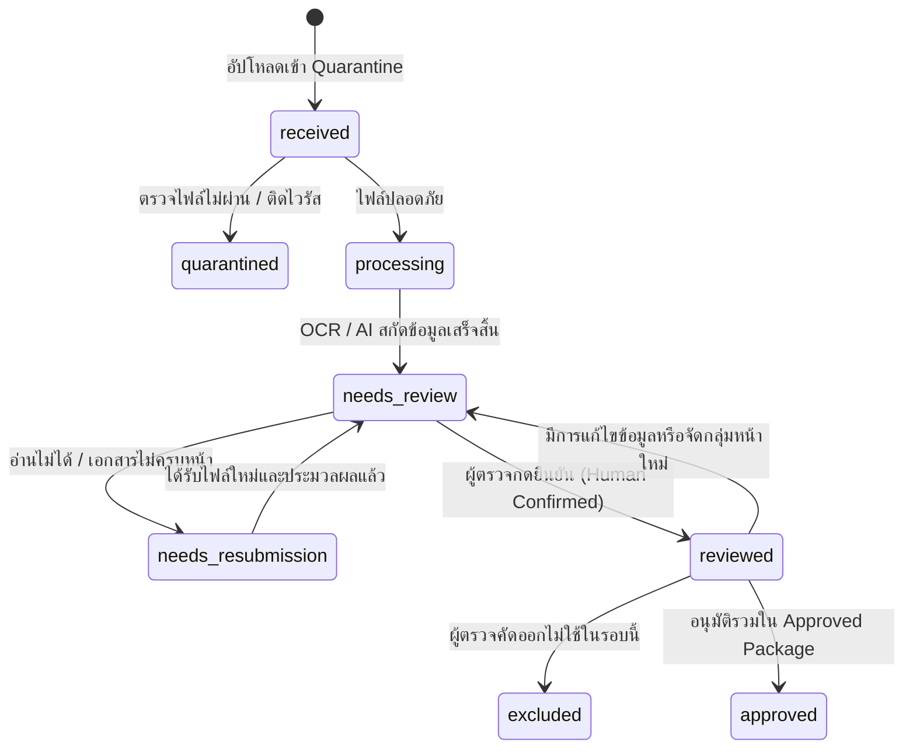

# DocReady — Operational Baselines & Review Workflow Specification (DR-005)

**เวอร์ชัน:** 1.0 | **วันที่:** 6 ตุลาคม 2026 | **สถานะ:** S0 Spec Approved

---

## 1. ตัวชี้วัดเป้าหมายและ Baseline การทำงาน (Operational Baselines & Metrics)

เป้าหมายสำคัญของระบบ DocReady คือการเพิ่มประสิทธิภาพในการจัดชุดเอกสาร โดยมีตัวชี้วัดหลักเทียบกับการทำงานด้วยมือ (Baseline Manual Preparation):

| มิติการวัด (Metric Dimension) | Baseline เดิม (Manual Baseline) | เป้าหมายของ DocReady | วิธีการวัดผล (Measurement Method) |
|---|---|---|---|
| **เวลาจัดชุดและตรวจเอกสาร** | ~15–20 นาที / 100 เอกสาร | **ลดลง ≥ 30%** (เหลือ ≤ 10–14 นาที) | วัด Active preparation/review time จาก Audit Events |
| **อัตราการส่งกลับแก้ไข (Rework Rate)** | 10–15% จากฟิลด์ตกหล่น | **ลดลงเหลือ < 5%** | นับจำนวน Package ที่ถูกย้อนสถานะหลัง Review |
| **เวลาในการตามเอกสารขาด** | 3–5 วันต่อรอบงาน | **ลดลงเหลือ < 1–2 วัน** | วัดระยะเวลาตั้งแต่ส่ง Missing Request จนถึง Responded |

---

## 2. วงจรสถานะงานคิวเอกสาร (Document Queue Lifecycle)



---

## 3. ข้อกำหนด UI/UX หน้า Side-by-Side Review Viewer (`/documents/[id]/review`)

หน้าจอตรวจเอกสารเป็นหน้าหลักที่พนักงานบัญชีใช้งานมากที่สุด จึงต้องออกแบบให้ทำงานได้อย่างรวดเร็วและไม่เมื่อยล้า:

```text
┌─────────────────────────┬──────────────────────────────────┬─────────────────────────────────┐
│ คิวเอกสาร (Queue List)  │ ภาพเอกสารต้นฉบับ (Document View) │ ฟิลด์ข้อมูลที่ต้องตรวจ (Editor)│
│ [ ] INV-2026-001 (รอ)   │ ซูม / หมุน / เปลี่ยนหน้า        │ ชนิด: ใบกำกับภาษี               │
│ [x] INV-2026-002 (ผ่าน) │ Highlight Polygon ตามฟิลด์       │ เลขที่: INV-2026-002            │
│ [!] REC-9941 (อ่านยาก)  │                                  │ วันที่: 05/10/2569 (BE)          │
│                         │                                  │ ยอดรวม: 1,250.00 THB            │
│                         │                                  │ [แก้] [ยืนยัน (Ctrl+Enter)]     │
└─────────────────────────┴──────────────────────────────────┴─────────────────────────────────┘
```

### Key UI Features:
1. **Synchronized Highlight**: เมื่อเลือก Focus ในช่องฟิลด์ข้อมูล (เช่น `grand_total`) ภาพเอกสารฝั่งซ้ายจะวิ่งและ Highlight ไปยังพิกัด Polygon/Span ของค่านั้นโดยอัตโนมัติ
2. **Keyboard Navigation Shortcuts**:
   - `Ctrl + Enter` / `Cmd + Enter`: ยืนยันเอกสารและไปยังใบถัดไป (`Confirm & Next`)
   - `Tab` / `Shift + Tab`: สลับฟิลด์ข้อมูลที่ต้องตรวจ
   - `R`: หมุนภาพ (Rotate 90 deg)
   - `Z`: Zoom in / Zoom out
3. **Accessibility**: ไม่ใช้สีเพียงอย่างเดียวในการบอกสถานะปัญหา (ต้องใช้ ไอคอน + ข้อความอธิบาย เช่น `[!] อ่านไม่ชัด`, `[x] เอกสารซ้ำ`)
