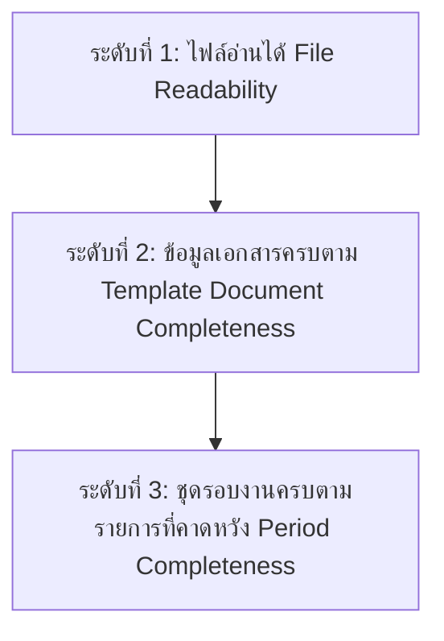

# DocReady — Checklist & Completeness Policy Specification (DR-003b)

**เวอร์ชัน:** 1.0 | **วันที่:** 6 ตุลาคม 2026 | **สถานะ:** S0 Spec Approved

---

## 1. ภาพรวมนโยบายความครบถ้วน (Completeness Policy Overview)

เอกสารนี้กำหนดเกณฑ์การวัดความครบถ้วนของชุดเอกสาร (Completeness Criteria) การบริหารจัดการรายการที่คาดหวัง (Expected Items) และนโยบายการตรวจสอบใบกำกับภาษีตามประมวลรัษฎากร มาตรา 86/4 สำหรับระบบ DocReady

---

## 2. การประเมินความครบถ้วน 3 ระดับ (3-Tier Completeness Architecture)

ระบบ DocReady ประเมินความพร้อมของเอกสารเป็น 3 ระดับที่ไม่ปะปนกัน:

### 2.1 ระดับที่ 1: ไฟล์อ่านได้ (File Readability Level)
- **เกณฑ์**: ไฟล์ผ่านการสแกนความปลอดภัย (Quarantine Scan Passed), ไม่ติดรหัสผ่าน, ไม่เสียหาย (Not Corrupted), จำนวนหน้าครบถ้วน และความคมชัดเพียงพอต่อการอ่าน

### 2.2 ระดับที่ 2: ข้อมูลเอกสารครบตาม Template (Document-Level Completeness)
- **เกณฑ์**: ฟิลด์ข้อมูลสำคัญตามชนิดเอกสารมีครบถ้วน (เช่น เลขที่เอกสาร, วันที่, ชื่อคู่ค้า, ยอดรวม, ภาษี) หรือมีสถานะเป็น `exception` ที่ Reviewer ได้รับทราบและยอมรับแล้ว

### 2.3 ระดับที่ 3: ชุดรอบงานครบตามรายการที่คาดหวัง (Period-Level Completeness)
- **เกณฑ์**: เอกสารที่ได้รับและผ่านการอนุมัติ สามารถจับคู่ (Match) กับรายการเอกสารที่คาดหวัง (`expected_items`) ของรอบงานนั้น ๆ ได้ครบตามเงื่อนไข

---

## 3. ฐานการรับรองความครอบคลุม (Coverage Bases)

ระบบห้ามแสดงผลว่าเอกสารของกิจการ "ครบ 100%" หากไม่มีรายการที่คาดหวังอ้างอิง โดยต้องแสดงผลตาม `coverage_basis` ดังนี้:

| ค่า Coverage Basis | เงื่อนไขการแสดงผล | ข้อความเตือนบน UI / Export |
|---|---|---|
| `complete_against_defined_list` | มีรายการคาดหวัง (`expected_items`) และจับคู่เอกสารครบทุกรายการที่ `required = true` | "เอกสารครบถ้วนตามรายการที่กำหนดสำหรับรอบงานนี้" |
| `received_documents_with_exceptions` | เอกสารมาไม่ครบตามรายการคาดหวัง แต่ Reviewer ยืนยันอนุมัติชุดโดยมีรายการข้อยกเว้น (`exceptions`) | "จัดชุดเอกสารพร้อมรายการข้อยกเว้น (Exceptions Acknowledged)" |
| `received_only` | **ไม่มีการกำหนดรายการที่คาดหวัง** สำหรับรอบงานนี้ | "จัดชุดจากเอกสารที่ได้รับแล้วเท่านั้น (Received Only) — ไม่สามารถยืนยันความครบถ้วนของทั้งกิจการได้" |

---

## 4. รายการที่คาดหวังและการจัดการเอกสารขาด (Expected Items & Missing Requests)

### 4.1 แหล่งที่มาของ Expected Items
1. **Checklist Template ประจำรอบ**: เช่น เอกสารค่าเช่า หรือค่าบริการประจำเดือนที่ต้องส่งทุกรอบ
2. **รายการที่นักบัญชีสร้างเอง (Manual Expected Item)**: เพิ่มรายการเฉพาะกิจ
3. **การนำเข้าจาก CSV ทะเบียนรายการ**: นำเข้ารายการคาดหวังจากระบบภายนอก

### 4.2 กระบวนการติดตามเอกสารขาด (Missing Document Request Workflow)
1. **สร้าง Draft คำขอ**: พนักงานสร้างรายการเอกสารที่ขาดในระบบ (`missing_requests`)
2. **เผยแพร่ไปยัง Client Portal**: คำขอที่ได้รับการตรวจสอบแล้วจะแสดงในหน้า Client Portal ของบริษัทลูกค้านั้น ๆ
3. **ลูกค้าตอบกลับ**: ลูกค้าสามารถ upload ไฟล์ใหม่ หรือกรอกคำอธิบาย (เช่น "เดือนนี้ไม่มีรายการ")
4. **มนุษย์ยืนยันการปิดคำขอ**: การ upload ไฟล์ใหม่หรือคำอธิบาย **ยังไม่ปิดคำขออัตโนมัติ** จนกว่า Reviewer จะกดยืนยัน (`resolved`)

---

## 5. นโยบายการตรวจสอบใบกำกับภาษี (Tax Invoice Verification Policy & Disclaimer)

### 5.1 รายการตรวจสอบตามมาตรา 86/4 แห่งประมวลรัษฎากร
ระบบ DocReady ทำการตรวจสอบฟิลด์สำคัญบนใบกำกับภาษีแบบเต็มรูป ดังนี้:
1. มีคำว่า "ใบกำกับภาษี" ในที่เห็นได้เด่นชัด
2. ชื่อ ที่อยู่ และเลขประจำตัวผู้เสียภาษีอากรของผู้ขาย
3. ชื่อ ที่อยู่ และเลขประจำตัวผู้เสียภาษีอากรของผู้ซื้อ
4. หมายเลขลำดับของใบกำกับภาษีและหมายเลขลำดับของเล่ม (ถ้ามี)
5. ชื่อ ชนิด ประเภท ปริมาณ และมูลค่าของสินค้าหรือบริการ
6. จำนวนภาษีมูลค่าเพิ่มที่ยื่นชำระ
7. วัน เดือน ปี ที่ออกใบกำกับภาษี

### 5.2 ข้อความปฏิเสธความรับผิดชอบทางกฎหมาย (Legal Disclaimer)
> [!WARNING]
> **การประมวลผลและการแสดงผลของระบบ DocReady เป็นเพียงการตรวจสอบการปรากฏของข้อมูลบนภาพเอกสาร (Field Presence Check) เท่านั้น ระบบไม่ได้ให้คำรับรองทางกฎหมายหรือรับประกันสิทธิ์การนำภาษีซื้อไปหักในการยื่นภาษีประมวลรัษฎากร ผู้ใช้งาน (นักบัญชี/ผู้ตรวจ) มีหน้าที่เป็นผู้ยืนยันความถูกต้องและสิทธิ์ทางภาษีตามกฎหมายก่อนการอนุมัติยื่นแบบทุกครั้ง**
