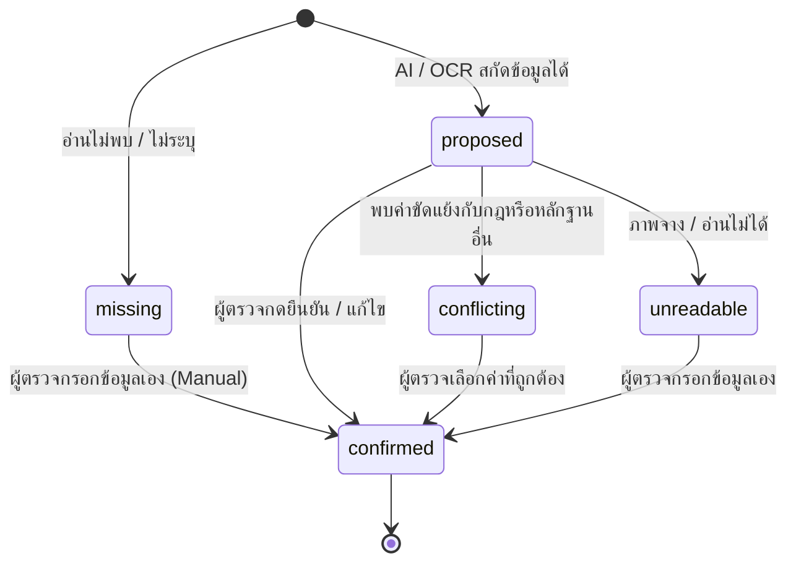

# DocReady — Document Field Dictionary & Data Specifications (DR-003)

**เวอร์ชัน:** 1.0 | **วันที่:** 6 ตุลาคม 2026 | **สถานะ:** S0 Spec Approved

---

## 1. ภาพรวมพจนานุกรมข้อมูล (Field Dictionary Overview)

เอกสารนี้ระบุนิยามของฟิลด์ข้อมูล รูปแบบการจัดเก็บ (Data Types) สถานะของฟิลด์ (Field Status State Machine) และโครงสร้างหลักฐานพิกัดอ้างอิง (Provenance) สำหรับระบบ DocReady ทุกการประมวลผลข้อมูลต้องปฏิบัติตามมาตรฐานในเอกสารนี้อย่างเคร่งครัด

---

## 2. นิยามโครงสร้างฟิลด์เอกสาร (Core Document Fields)

| ชื่อฟิลด์ (Field Name) | ประเภทข้อมูล (Data Type) | กฎและรูปแบบการจัดเก็บ (Validation Rules & Format) | ตัวอย่างข้อมูล (Example) |
|---|---|---|---|
| `client_company_id` | `UUID` | ต้องตรงกับบริษัทลูกค้าที่ได้รับสิทธิ์ ไม่เปลี่ยนข้าม scope | `"c4b12a89-..."` |
| `document_roles` | `Array<String>` | สับเซตของ `["invoice", "receipt", "tax_invoice", "payment_evidence", "other"]` เอกสาร 1 ใบมีได้หลายบทบาท | `["invoice", "tax_invoice"]` |
| `primary_queue_category`| `String` | หมวดหมู่หลักสำหรับจัดเข้าคิว (`invoice`, `receipt`, `tax_invoice`, `payment_proof`, `unknown`) | `"tax_invoice"` |
| `document_number` | `String` | **ห้ามแปลงเป็น Number/Float** ต้องรักษา `0` นำหน้า ขีด และอักษรพิเศษไว้ทั้งหมด | `"INV-2026-0042"` |
| `document_date` | `Object` | ประกอบด้วย `raw_text` (ตามที่อ่านได้), `normalized_iso` (`YYYY-MM-DD`), `calendar_basis` (`BE` \| `CE`), `review_status` | `{"raw_text": "05/10/2569", "normalized_iso": "2026-10-05", "calendar_basis": "BE"}` |
| `seller` | `PartyObject` | `name`, `address`, `tax_id` (`String`), `branch` (`String` e.g. `"00000"`) | `{"name": "บริษัท เอ บี ซี จำกัด", "tax_id": "0105558000123", "branch": "00000"}` |
| `buyer` | `PartyObject` | `name`, `address`, `tax_id` (`String`), `branch` (`String`) | `{"name": "บริษัท ลูกค้าตัวอย่าง จำกัด", "tax_id": "0105559000999", "branch": "00001"}` |
| `amounts` | `AmountsObject` | ใช้ `Decimal String` ห้ามใช้ Float: `subtotal`, `stated_tax`, `grand_total`, `amount_paid`, `currency` | `{"grand_total": "1250.00", "stated_tax": "81.78", "subtotal": "1168.22", "currency": "THB"}` |
| `declared_tax_rate` | `Decimal String` | เก็บเฉพาะเมื่อมีระบุจริงบนเอกสาร (เช่น `"7.00"`) **ห้ามเดาเติม 7.00 หากไม่ปรากฏ** | `"7.00"` หรือ `null` |
| `document_direction` | `Enum` | `purchase` (ซื้อ/จ่าย), `sales` (ขาย/รับ), `unknown` | `"purchase"` |
| `accounting_period` | `String` | รอบบัญชีที่คนระบุ (`YYYY-MM`) เช่น `"2026-10"` ไม่ตั้งตาม `document_date` อย่างตายตัว | `"2026-10"` |
| `quality_flags` | `Array<String>` | สับเซตของ `["blurred", "cropped", "missing_pages", "low_ocr", "ambiguous"]` | `["low_ocr"]` |

---

## 3. สถานะข้อมูลของฟิลด์ (Field Status State Machine)

ทุกฟิลด์ในระบบต้องระบุสถานะ (`field_status`) เพื่อแยกข้อมูลที่ AI เสนอออกจากข้อมูลที่มนุษย์ยืนยัน:



### รายละเอียดสถานะ:
- `missing`: ไม่พบข้อมูลบนเอกสาร
- `proposed`: ข้อมูลเสนอจาก OCR/Jev (ยังรอผู้ตรวจยืนยัน)
- `confirmed`: ผู้ตรวจกดยืนยันหรือแก้ไขแล้ว (**ห้ามถูก AI/OCR ประมวลผลทับ**)
- `conflicting`: มีข้อมูลหลายค่าขัดแย้งกัน (เช่น ยอดรวมไม่ตรงกับ Subtotal + Tax)
- `unreadable`: ข้อความจาง ตัดขอบ หรืออ่านไม่ได้
- `not_applicable`: ฟิลด์นี้ไม่เกี่ยวข้องกับประเภทเอกสารดังกล่าว

---

## 4. โครงสร้างหลักฐานพิกัดอ้างอิง (Evidence Provenance Schema)

เพื่อปฏิบัติตามหลักการ **Evidence-Backed Data** ทุกค่าที่สกัดได้จาก OCR หรือ AI ต้องผูกกับวัตถุ `provenance` เสมอ:

```json
{
  "field": "grand_total",
  "status": "proposed",
  "raw_text": "1,250.00",
  "normalized_value": "1250.00",
  "currency": "THB",
  "evidence": {
    "asset_version": "asset_v1_8f9a2",
    "page": 1,
    "ocr_run_id": "ocr_run_9941a",
    "span_ids": ["span_104", "span_105"],
    "bounding_box": {
      "x": 0.72,
      "y": 0.84,
      "width": 0.15,
      "height": 0.03
    }
  },
  "decision_run_id": "decision_run_3312b"
}
```
---

## 5. กฎควบคุมความถูกต้องเชิงตัวเลขและประเภทข้อมูล (Precision & Rule Enforcement)

1. **การคำนวณตัวเลขเงิน**:
   - $GrandTotal = Subtotal + StatedTax$ (ต้องใช้ Decimal Arithmetic)
   - หากยอดบนเอกสารมี Tolerance ของร้านค้า (เช่น ปัดเศษสตางค์) ให้ติดธง `conflicting` เพื่อให้มนุษย์ตรวจสอบ ห้ามปรับตัวเลขเอง
2. **Missing != Zero**:
   - หากไม่พบยอดภาษีบนเอกสาร ให้ตั้งค่าสถานะเป็น `missing` **ห้ามใส่ `0.00`**
3. **การรักษาเลขศูนย์นำหน้า**:
   - เลขผู้เสียภาษี 13 หลัก เช่น `"0105558000123"` และสาขา 5 หลัก เช่น `"00000"` ต้องคงรูปแบบ String สตริงเดิมทุกขั้นตอนใน API, DB และ Export Workbook
