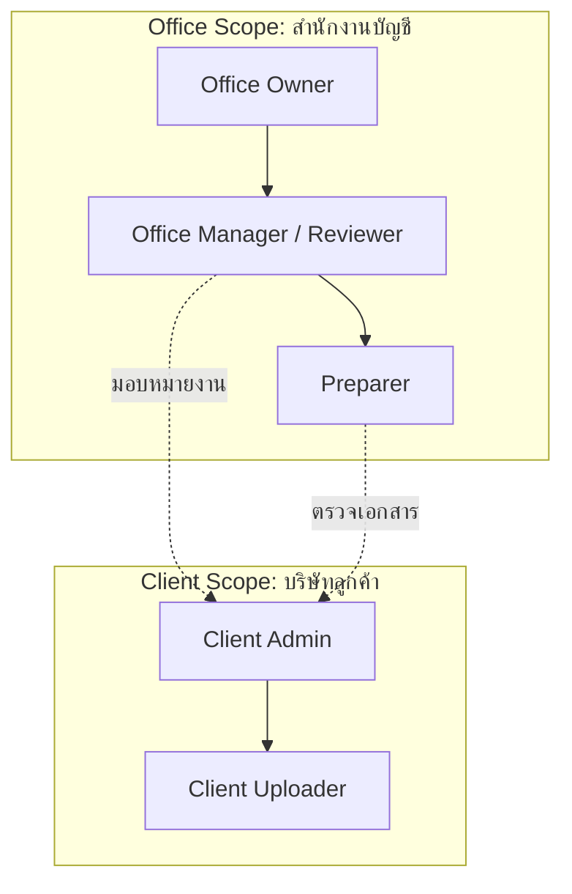

# DocReady — Product Brief & Scope Specification (DR-001 & DR-002)

**เวอร์ชัน:** 1.0 | **วันที่:** 6 ตุลาคม 2026 | **สถานะ:** S0 Spec Approved

---

## 1. บริบทและวัตถุประสงค์ (Executive Summary)

**DocReady** เป็นระบบบริหารจัดการ คัดแยก ตรวจสอบตำแหน่งหลักฐาน (Evidence Tracking) ตรวจสอบความครบถ้วนของชุดเอกสาร (Checklist & Expected Items) และสร้างชุดส่งออกเอกสาร (Approved Export Bundle) เพื่อส่งต่อให้พนักงานทำบัญชีลงระบบได้อย่างรวดเร็ว แม่นยำ และมีร่องรอยการตรวจสอบ (Audit Trail)

คุณค่าหลักของผลิตภัณฑ์คือการ **ลดเวลาจัดชุดเอกสารและตามงาน** เพิ่มความชัดเจนของสถานะงานรายบริษัท และรับประกันว่าทุกข้อมูลสกัดมีหลักฐานอ้างอิงตำแหน่งบนภาพต้นฉบับ โดยไม่โอนย้ายการตัดสินใจทางบัญชี/ภาษีไปให้ระบบอัตโนมัติ

---

## 2. กลุ่มเป้าหมายและ Use Case หลัก (Target Audience & Use Cases)

### 2.1 กลุ่มผู้ซื้อและผู้ใช้งาน
- **ผู้ซื้อหลัก (Primary Buyer)**: สำนักงานบัญชีไทยขนาดเล็กถึงขนาดกลาง (Small-to-Medium Accounting Firms) ที่รับทำบัญชีให้หลายบริษัทลูกค้า (Multi-client management)
- **ผู้ใช้ฝั่งสำนักงานบัญชี (Firm Staff)**: Office Owner, Office Manager/Reviewer, Preparer
- **ผู้ใช้ฝั่งบริษัทลูกค้า (Client Staff)**: Client Admin, Client Uploader

### 2.2 Use Case หลักในรุ่นเริ่มต้น (MVP Scope)
- **เน้นกลุ่มรายจ่ายและซื้อของของ SME ธุรกิจบริการ**:
  - ใบแจ้งหนี้ (Invoice)
  - ใบเสร็จรับเงิน (Receipt)
  - ใบกำกับภาษี (Tax Invoice / Combined Invoice-Receipt)
  - หลักฐานการชำระเงิน (Payment Proof / Transfer Slip)
  - เอกสารอื่น ๆ ที่พนักงานจัดหมวด (`other` / `requires_specialist_review`)

---

## 3. ขอบเขตการทำงาน (In-Scope vs. Out-of-Scope)

| หมวดหมู่ | ในขอบเขต MVP (In-Scope) | เลื่อนไปรุ่นถัดไป / นอกขอบเขต (Out-of-Scope) |
|---|---|---|
| **ช่องทางรับไฟล์** | Web Portal Upload (PDF, JPEG, PNG) | LINE, Email Integration, Google Drive Sync |
| **ขนาดไฟล์และ Quota** | สูงสุด 20 MB/ไฟล์, 30 หน้า/ไฟล์, 50 ไฟล์/batch | ระบบประมวลผลไฟล์วิดีโอ หรือไฟล์บีบอัด ZIP ทางหน้าเว็บ |
| **การอ่านข้อมูล** | ข้อมูลส่วนหัว, คู่ค้า (Seller/Buyer), วันที่, เลขที่เอกสาร, ยอดรวม, ยอดภาษี, ยอดชำระ | สกัดรายการสินค้าทุกบรรทัด (Full Line-Item Extraction) |
| **การตรวจเอกสาร** | Side-by-side evidence viewer, Highlight polygon/spans, Human field confirmation | อนุมัติตัวเลข หรืออนุมัติการลงบัญชีอัตโนมัติ |
| **การตรวจสิทธิ์ภาษี** | ตรวจสอบตามกฎหมายมาตรา 86/4 (พบ/ไม่พบ/ต้องตรวจ) | การรับรองสิทธิ์หักภาษี หรือยืนยันความแท้จริงของร้านค้า |
| **การส่งออก** | XLSX (Document Register) + ZIP (Sanitized Documents) + Manifest JSON | การเชื่อมต่อตรงผ่าน API เข้าซอฟต์แวร์บัญชี (e.g. PEAK, FlowAccount) |

---

## 4. ผู้ใช้งานและขอบเขตสิทธิ์ (User Personas & Role-Based Access Control)

ระบบใช้ **Dual-Level Security Scope**:
1. **Office Level**: สิทธิ์ในระดับสำนักงานบัญชี
2. **Client Company Level**: สิทธิ์ในระดับบริษัทลูกค้า

### รายละเอียดสิทธิ์ในแต่ละ Role:
- **Office Owner**: บริหารจัดการสมาชิกสำนักงาน, บริษัทลูกค้า, กำหนด Budget และการลบข้อมูล (Retention)
- **Office Manager / Reviewer**: มอบหมายพนักงาน, ตรวจสอบและยืนยันข้อมูล, จัดการ Checklist, อนุมัติแพ็กเกจส่งออก (`Approved Package`)
- **Preparer**: จัดหมวดหมู่เอกสาร, แก้ไขฟิลด์ข้อมูล, เตรียมคำขอเอกสารที่ขาด
- **Client Admin**: จัดการผู้ส่งเอกสารภายในบริษัทลูกค้า, ดูสถานะคำขอเอกสารที่ขาด
- **Client Uploader**: อัปโหลดไฟล์เอกสารเข้าตามรอบงาน และตอบคำขอเอกสารที่ขาดเฉพาะบริษัทตนเอง

---

## 5. ความเสี่ยงและแนวทางควบคุม (Key Risk Mitigations)

1. **ข้อมูลรั่วไหลข้ามบริษัทลูกค้า (Multi-tenant Data Leakage)**:
   - ตรวจสอบ `office_id` และ `client_id` ทั้งที่ Server-Side API, DB RLS Policies, และ Composite Foreign Keys
2. **ความผิดพลาดจาก AI/OCR (AI Rounding & Hallucination)**:
   - AI/OCR ทำหน้าที่เสนอ candidate เท่านั้น (`status: proposed`)
   - ตัวเลขเงินใช้ประเภท `Decimal` ห้ามใช้ Float
   - เลขที่เอกสารและเลขภาษีรักษาเป็น `String` ห้ามตัด 0 ข้างหน้า
3. **การสูญหายของร่องรอยการแก้ไข (Audit Trail Loss)**:
   - เอกสารต้นฉบับ (`source_assets`) เป็น Immutable
   - การอนุมัติแพ็กเกจเป็นการทำ Snapshot ยึดตามเวอร์ชันเอกสารและเวอร์ชัน Checklist ในขณะนั้น
