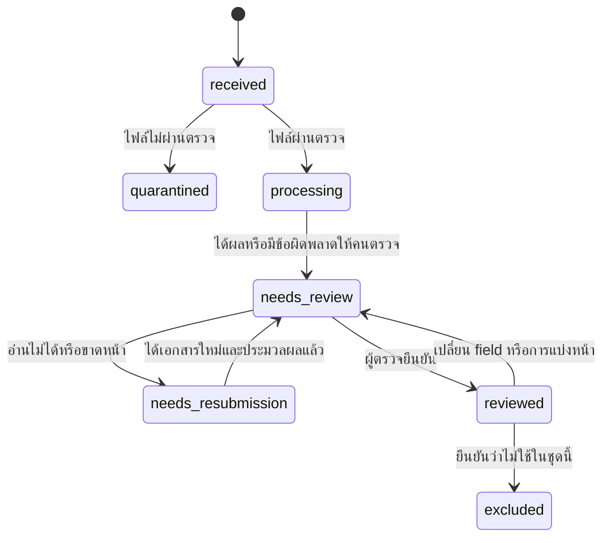
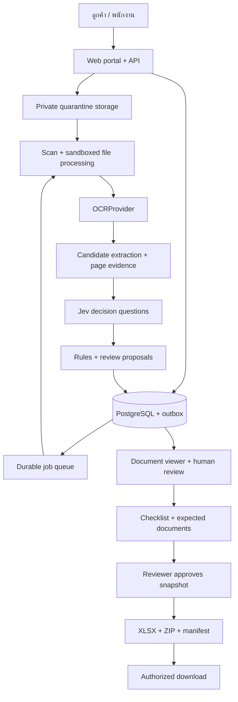

**DocReady — Implementation Plan สำหรับระบบเตรียมชุดเอกสารให้บัญชี**

วันที่: 5 ตุลาคม 2026 | เวอร์ชัน: 1.0 | สถานะ: แผนพัฒนาที่ยังไม่ได้ลงมือสร้างแอพหรือทดสอบ OCR/Jev ด้วยเอกสารจริง

เอกสารนี้เป็นแผนของ DocReady โดยเฉพาะ ต่อจากแนวคิดใน [แผน JEV สำหรับ SME](D:/Projects/JEV-Projects/JEV-SME-SAAS-PLAN.th.md) เสนอให้สร้างโค้ดแอพใน `D:\Projects\JEV-Projects\DocReady` เมื่อเริ่ม implementation ส่วนไฟล์แผนนี้อยู่ที่ root ของ workspace งานและ checkbox ด้านล่างยังไม่ถือว่าทำเสร็จ

**01. เป้าหมายผลิตภัณฑ์:** ช่วยรับ จัดหมวด ตรวจ และจัดชุดเอกสารรายบริษัท/รอบงานให้พนักงานบัญชีทำต่อได้เร็วขึ้น

เส้นทางหลัก: ลูกค้าส่งไฟล์ → ตรวจไฟล์ → อ่านข้อความด้วย OCR → แบ่งเอกสารและจัดหมวด → เสนอข้อมูลพร้อมตำแหน่งต้นฉบับ → คนตรวจ → ตรวจ checklist/รายการที่คาดว่าจะได้รับ → ตามเอกสารที่ขาด → จัดชุดและส่งออก

คุณค่าที่ขายคือเวลาที่ลดลงในการจัดเอกสารและตามงาน ความชัดเจนว่าเอกสารอยู่ขั้นไหน และความสามารถตรวจย้อนกลับ ผลลัพธ์เป็น “ชุดเอกสารที่ตรวจแล้วพร้อมส่งให้บัญชีตามขอบเขตที่กำหนด” การลงบัญชี การตัดสินสิทธิภาษี และการยื่นแบบยังอยู่ในขั้นตอนของผู้รับผิดชอบ

สมมติฐานตั้งต้นคือสำนักงานบัญชีที่รับเอกสารจากลูกค้าหลายบริษัท ให้หนึ่งสำนักงานเป็นหนึ่ง workspace และมี client companies ภายใน หากเริ่มจากฝ่ายบัญชี SME ให้ใช้ workspace เดียวกับ client company เดียวได้โดยไม่เปลี่ยนแกนข้อมูล

**02. ขอบเขตตั้งต้นและจุดตัดสินใจ:** ใช้เพื่อจำกัด MVP ให้ทดสอบคุณค่าได้จริง

| เรื่อง | ข้อเสนอเริ่มต้น | ต้องยืนยันใน S0 |
|---|---|---|
| กลุ่มผู้ซื้อ | สำนักงานบัญชีไทยขนาดเล็ก–กลาง | วิธีรับเอกสารเดิม ใครตรวจ ใครตัดสินความพร้อม |
| Pilot | 2 สำนักงาน รวม 6 บริษัทลูกค้า ผู้ใช้ประมาณ 10–15 คน | ต้องเป็นข้อมูลที่ได้รับอนุญาตและมีนักบัญชีร่วมตรวจ |
| รอบงาน | ชุดเอกสารรายเดือนที่สำนักงานกำหนด | รอบงานไม่ถูกตีความเป็นเดือนภาษีอัตโนมัติ |
| เอกสารแกนหลัก | invoice, receipt, tax invoice และเอกสารรวมหลายบทบาท | เลือกกลุ่มรายจ่าย/ซื้อของ SME ธุรกิจบริการเป็น use case แรก |
| เอกสารประกอบ | หลักฐานชำระเงิน และเอกสารอื่นที่คนจัดหมวด | เก็บและเชื่อมได้ แต่ไม่ตรวจความแท้ของสลิป |
| ช่องทางรับ | Web portal / upload ของพนักงาน | LINE, อีเมล และ Drive integration เป็นรุ่นถัดไป |
| ไฟล์ | PDF, JPEG, PNG; เริ่ม 20 MB/ไฟล์, 30 หน้า/ไฟล์, 50 ไฟล์/batch | เป็นเพดานผลิตภัณฑ์ที่ปรับได้ ไม่ใช่ข้อจำกัดผู้ให้บริการ |
| การอ่านข้อมูล | ข้อมูลส่วนหัว คู่ค้า วันที่ ยอดรวม ภาษีที่ปรากฏ และสกุลเงิน | รายการสินค้าทุกบรรทัดไม่อยู่ใน MVP |
| การอนุมัติ | พนักงานตรวจ field สำคัญและยืนยันชุดก่อน export | ผู้จัดเตรียม/ผู้ตรวจแยกคนได้ตามนโยบายสำนักงาน |
| การส่งออก | XLSX + ZIP + manifest JSON + exceptions report | เลือก mapping หนึ่งแบบกับสำนักงาน pilot |
| ทีมพัฒนา | full-stack 1 คน, PO บางเวลา, นักบัญชี domain reviewer | 50 วันทำงานพื้นฐาน; ประมาณ 10–12 สัปดาห์รวม buffer |

ก่อนมีข้อมูลจริง ใช้ fixtures สังเคราะห์ที่มีป้าย demo สร้าง UI/สิทธิ์/workflow ต่อได้ ผล demo ไม่ใช้รับรองความแม่นยำหรือความครบของงานจริง

**03. ขอบเขตการส่งมอบ:** แกนหลักต้องทำงานได้ด้วยมือแม้ OCR หรือ AI ไม่พร้อม

| รุ่น | สิ่งที่ต้องมี | สิ่งที่เลื่อนไประยะถัดไป |
|---|---|---|
| Demo ภายใน | บริษัทลูกค้า รอบงาน upload preview manual fields checklist export ตัวอย่าง | ไม่ต้องต่อบัญชีจริงหรือส่งข้อมูลออก API |
| MVP pilot | portal, OCR, Jev, review, duplicate flags, missing requests, approved export, audit | เชื่อม LINE/อีเมล/บัญชี, รายการสินค้าเต็มบรรทัด, bank reconciliation |
| ใช้จัดหมวดอัตโนมัติบางส่วน | แนะนำ/ติดหมวดเฉพาะชนิดที่ evaluation ผ่าน | ไม่อนุมัติตัวเลข ภาษี ชุดเอกสาร หรือการลงบัญชีอัตโนมัติ |
| v1.1 หลัง pilot | accounting mappings, ช่องทางรับเพิ่ม, templates เฉพาะแบบ, billing | ทำตามหลักฐานว่าช่วยลดเวลาหรือขายได้เพิ่ม |

เก็บ withholding certificates, credit/debit notes, bank statements และเอกสารซับซ้อนเป็น `other/requires_specialist_review` ในรุ่นแรกได้ แต่ไม่สัญญาว่าจะสกัดทุก field อย่างถูกต้อง งานเงินเดือน ข้อมูลธนาคารแบบเชื่อมสด การอนุมัติจ่ายเงิน และการยื่นภาษีไม่อยู่ใน MVP

**04. สิ่งที่ Jev และ OCR รับผิดชอบ:** แยกการอ่านตัวอักษร การเข้าใจบทบาทข้อมูล และการตรวจธุรกิจ

Jev รุ่นที่เอกสารระบุขณะตรวจคือ `jev-1.13.0` รับข้อความเท่านั้นและต้องทดสอบภาษาไทยกับงานจริง จึงต้องมี OCR ก่อน Jev สำหรับเอกสารภาพ และต้อง pin model/version หลังประเมิน [TypeSafe Models](https://docs.typesafe.ai/models)

| ส่วน | หน้าที่ | ไม่ใช้ส่วนนี้ตัดสิน |
|---|---|---|
| OCR | อ่านข้อความและตำแหน่งบนหน้า | ความถูกต้องทางบัญชี/ภาษี |
| Jev | เลือกชนิดเอกสาร เลือกว่าค่าต้นฉบับใดเป็นผู้ขาย/วันที่/ยอดรวม และคัดงานให้ตรวจ | สร้างเลขเอกสารหรือจำนวนเงินที่อ่านไม่พบ |
| โค้ด | คำนวณ ตรวจรูปแบบ จัดการเวอร์ชัน สิทธิ์ checklist และความสัมพันธ์ | เติมข้อมูลธุรกิจที่ต้นฉบับไม่ระบุ |
| นักบัญชี/ผู้ตรวจ | ยืนยันค่า แก้กรณีกำกวม จัดรอบงาน และอนุมัติชุด | ไม่ต้องไล่เปิดไฟล์ซ้ำเพื่อหาค่าที่ UI ชี้ได้ |

ข้อเสนอ OCR เริ่มต้นคือ Azure Document Intelligence Read: เอกสารระบุรองรับภาษาไทยและคืนตำแหน่งข้อความ/ความเชื่อมั่นสำหรับการอ่าน แต่คุณภาพบนภาพถ่าย ใบเสร็จจาง และรูปแบบร้านไทยต้องประเมินเอง [ภาษาที่รองรับ](https://learn.microsoft.com/en-us/azure/ai-services/document-intelligence/language-support/ocr?view=doc-intel-4.0.0), [Read output](https://learn.microsoft.com/en-us/azure/ai-services/document-intelligence/prebuilt/read?view=doc-intel-4.0.0)

วาง OCRProvider interface เพื่อเทียบทางเลือกได้ และไม่ตั้งสมมติฐานว่า language support ของ OCR เท่ากับการรองรับ Thai invoice field extraction ของ prebuilt invoice model ต้องตรวจเป็นคนละความสามารถ

**05. ผู้ใช้และขอบเขตสิทธิ์:** ใช้ทั้ง office scope และ client-company scope

| Role | สิทธิ์ใน MVP |
|---|---|
| Office Owner | บริหารสำนักงาน สมาชิก บริษัทลูกค้า นโยบาย retention/budget และข้อมูลในสำนักงาน |
| Office Manager / Reviewer | จัดผู้รับผิดชอบ ตรวจ แก้ checklist และอนุมัติชุดของบริษัทที่ได้รับสิทธิ์ |
| Preparer | รับ/จัดเอกสาร แก้ field เตรียมรายการขาดของบริษัทที่ได้รับมอบหมาย |
| Client Admin | จัดการผู้ส่งเอกสารและดูรายการขาด/สถานะของบริษัทตัวเอง |
| Client Uploader | ส่งไฟล์และตอบคำขอเฉพาะบริษัทและรอบงานที่ได้รับสิทธิ์ |
| Read-only Reviewer | อ่านเอกสารที่ได้รับสิทธิ์; export ต้องมีสิทธิ์แยก |

สิทธิ์ client ไม่เกิดจากการเป็นสมาชิก office โดยอัตโนมัติ พนักงานที่ได้รับมอบหมายบริษัท A ต้องไม่เปิด B ได้แม้อยู่สำนักงานเดียวกัน บทบาทลูกค้าไม่เห็น internal review notes, vendor matching notes หรือบริษัทอื่น ผู้ใช้หนึ่งคนมีหลายบริษัทได้ผ่าน membership ที่ระบุชัด ไม่เชื่อมด้วยชื่อ/อีเมลคล้ายกัน

**06. User stories และเกณฑ์ตรวจรับ:** ให้ทุกฟีเจอร์เชื่อมกับงานจริง

| ID | ความต้องการ | Acceptance |
|---|---|---|
| US-01 | สำนักงานตั้งบริษัทลูกค้าและรอบงาน | สมาชิกเห็นเฉพาะขอบเขตที่ได้รับสิทธิ์ |
| US-02 | ลูกค้าส่งหลายไฟล์และรู้ว่าส่งสำเร็จ | มี receipt/สถานะรายไฟล์ ไม่ถือว่า upload เท่ากับตรวจผ่าน |
| US-03 | พนักงานเห็นชนิดเอกสารและ field ที่เสนอ | กดดูหลักฐานตำแหน่งบนต้นฉบับได้ |
| US-04 | ผู้ตรวจแก้เลข/วันที่ที่ OCR อ่านผิด | เก็บค่าต้นฉบับ ค่าที่แก้ ผู้แก้ และ revision |
| US-05 | พนักงานแยก PDF ที่รวมหลายเอกสาร | ทุกหน้าถูกจัดกลุ่มหรือระบุว่าไม่ใช่เอกสาร ไม่มีหน้าหายเงียบ ๆ |
| US-06 | ผู้ตรวจเห็นเอกสารอาจซ้ำ | แสดงเหตุผลและให้ยืนยันความสัมพันธ์ ไม่ลบทิ้งเอง |
| US-07 | สำนักงานรู้ว่าขาดเอกสารอะไร | อ้าง checklist/expected item ที่กำหนด ไม่เดาจากกองเอกสารอย่างเดียว |
| US-08 | ลูกค้าตอบคำขอเอกสารที่ขาด | upload ใหม่เชื่อมกับคำขอเดิม แต่คนยังตรวจว่าตอบตรงเรื่อง |
| US-09 | ผู้ตรวจอนุมัติชุดและส่งออก | เป็น snapshot ที่เปลี่ยนย้อนหลังไม่ได้และมีรายการ exceptions |
| US-10 | ผู้ใช้ทำงานต่อเมื่อ OCR/Jev ล่ม | รับไฟล์ต่อได้และกรอกมือได้ตามสิทธิ์ |
| US-11 | ผู้ตรวจแก้หลังส่งออกแล้ว | สร้าง revision/ชุดใหม่โดยชุดเดิมยังตรวจย้อนหลังได้ |

**07. หน้าจอที่ออกแบบ:** ให้ตรวจเอกสารเป็นงานหลัก ส่วนตัวเลขโมเดลอยู่ในรายละเอียด

| Route ที่เสนอ | เนื้อหา | สถานะพิเศษที่ต้องมี |
|---|---|---|
| `/login`, `/onboarding` | ลงชื่อเข้าใช้ ตั้ง office เชิญสมาชิก | invite หมดอายุ, ไม่มีสิทธิ์, demo |
| `/clients` | บริษัทที่ได้รับมอบหมายและสถานะรอบงาน | ลูกค้ารายใหม่, สิทธิ์ถูกถอน |
| `/clients/[id]/periods/[periodId]` | เอกสารรับแล้ว คิวตรวจ รายการขาด และชุดส่งออก | ไม่มี checklist, ข้อมูลยังมาไม่ครบ |
| `/portal/[clientId]` | ลูกค้าส่งไฟล์และตอบคำขอ | upload ค้าง, ไฟล์ผิดประเภท, ส่งแล้วกำลังตรวจ |
| `/documents/inbox` | คิว file/document พร้อม filter | quarantined, unreadable, split required, provider error |
| `/documents/[id]/review` | viewer + field editor + หลักฐาน | ค่า ambiguous, mismatch, duplicate, revision ใหม่ |
| `/documents/[id]/pages` | รวม/แยกหน้าในขอบเขตเดียว | หน้าไม่ถูกจัด, หลายบริษัทปนกัน |
| `/requests` | คำขอเอกสารที่ขาดและคำตอบ | draft/published/responded/resolved |
| `/packages` | ตรวจชุด อนุมัติ สร้าง export ดาวน์โหลด | changed after approval, export failed, expired download |
| `/reports`, `/settings` | เวลา/ต้นทุน/คุณภาพ และกฎสำนักงาน | sample น้อย, budget ใกล้หมด |

```text
สำนักงาน / บริษัทลูกค้า / รอบงาน                    ค้นหา / ผู้ใช้
┌──────────────────┬──────────────────────────┬─────────────────────────┐
│ คิวเอกสาร        │ ภาพเอกสารต้นฉบับ        │ ข้อมูลที่ต้องตรวจ       │
│ ต้องตรวจ         │ ซูม / หมุน / เปลี่ยนหน้า │ ชนิด / คู่ค้า / วันที่  │
│ อ่านไม่ชัด       │ highlight ค่าอ้างอิง     │ เลขเอกสาร / ยอดรวม      │
│ อาจซ้ำ           │                          │ ค่าขัดกัน / สิ่งที่ขาด │
│ ขอใหม่           │                          │ [แก้] [ยืนยัน] [ขอใหม่]│
└──────────────────┴──────────────────────────┴─────────────────────────┘
```

Desktop ใช้สอง/สามคอลัมน์ตามพื้นที่; มือถือลูกค้าเน้นถ่าย/เลือกไฟล์และดูคำขอ พนักงานตรวจงานจำนวนมากบน desktop รองรับ keyboard, focus, loading, empty/error states และไม่ใช้สีอย่างเดียวบอกปัญหา

**08. แบบข้อมูลเอกสารและความหมายของ field:** ใช้ evidence-backed proposals แยกจากค่าที่คนยืนยัน

| Field | วิธีเก็บ / กฎ |
|---|---|
| client_company_id | มาจากช่องทาง/ผู้ใช้ที่ได้รับสิทธิ์; ถ้าต้นฉบับดูเป็นบริษัทอื่นให้ flag ไม่ย้ายเอง |
| document_roles | ชุดบทบาท invoice/receipt/tax_invoice/payment_evidence/other; เอกสารหนึ่งมีหลายบทบาทได้ |
| primary_queue_category | หมวดสำหรับคิวหนึ่งค่า + unknown; ไม่ลบบทบาทอื่น |
| document_number | string รักษาเลขศูนย์ข้างหน้าและอักษร; อาจ missing/unreadable |
| document_date | raw text, proposed ISO date, calendar basis, review status |
| seller/buyer | name/address/tax identifier/branch ที่มีหลักฐาน พร้อมบทบาทที่ยืนยัน |
| amounts | subtotal, stated_tax, grand_total, amount_paid และ currency แยกกัน ใช้ decimal |
| declared_tax_rate | เก็บเมื่อปรากฏจริง; ไม่เติมอัตราที่คาดเดา |
| document_direction | purchase/sales/unknown จากบริษัทเจ้าของและบทบาทคู่ค้า; คนยืนยัน |
| accounting_period | รอบที่คนกำหนด ไม่ตั้งตาม document_date อย่างตายตัว |
| quality_flags | blurred/cropped/missing_pages/low_ocr/ambiguous อ้างผลและเหตุ |
| field_status | missing/proposed/confirmed/conflicting/unreadable/not_applicable |
| provenance | source asset version, page, polygon/span IDs, OCR run, decision run |

ใช้เลขจำนวนเงินเป็น decimal string ที่ API และ numeric ในฐานข้อมูล เก็บ tax identifiers/เลขเอกสาร/branch เป็น string; normalize ตัวเลขไทยและ พ.ศ./ค.ศ. ด้วยกฎที่รักษาค่า raw เมื่อมีหลายตีความให้คนเลือก Missing amount ไม่เท่ากับศูนย์

การเลือก candidate จาก OCR ช่วยให้ค่ามาจากข้อความที่อ่านพบ แต่ OCR อาจอ่านผิดตั้งแต่แรก จึงต้องมีภาพต้นฉบับให้คนยืนยัน ไม่ถือว่า candidate-backed หมายถึงถูกต้องแน่นอน [TypeSafe candidate extraction](https://docs.typesafe.ai/cookbooks/pre_parsed_value_extraction_cookbook)

ตัวอย่าง evidence record ภายในของแอพ เป็นข้อมูลสมมติ ไม่ใช่ response จริงของ OCR/Jev:

```json
{
  "field": "grand_total",
  "status": "proposed",
  "raw_text": "1,250.00",
  "normalized_value": "1250.00",
  "currency": "THB",
  "evidence": {
    "asset_version": "asset_demo_v1",
    "page": 1,
    "ocr_run_id": "ocr_demo_01",
    "span_ids": ["span_42"]
  },
  "decision_run_id": "decision_demo_01"
}
```

**09. ความครบของเอกสาร:** แยกสามระดับที่ระบบตรวจต่างกัน

1. **ไฟล์อ่านได้:** scan ผ่าน จำนวนหน้าที่คาดไว้ครบ และภาพ/ข้อความพอให้ผู้ตรวจทำงาน
2. **ข้อมูลของเอกสารครบตาม template:** field ที่สำนักงานกำหนดมีหรือมีสถานะ exception ที่ Reviewer รับทราบ
3. **ชุดรอบงานครบตามรายการที่คาดหวัง:** มี expected items/checklist ที่กำหนดสำหรับบริษัทและรอบนั้น พร้อมการจับคู่ที่ยืนยันแล้ว

ถ้าไม่มี expected list ระบบแสดงได้เพียง “จัดชุดจากเอกสารที่ได้รับแล้ว” พร้อม `coverage_basis = received_only` ห้ามแสดงว่าเอกสารทั้งหมดของกิจการครบ ระบบต้องแยก missing field ออกจาก missing document

Expected items มาจาก (a) template ประจำเดือน เช่น เอกสารค่าเช่าที่ลูกค้าต้องส่งเมื่อมีรายการ (b) รายการที่นักบัญชีสร้างเอง (c) CSV ทะเบียนรายการที่ได้รับอนุญาตนำเข้าใน S6 แต่ละรายการมีแหล่งที่มา จำนวนที่คาดหวัง เงื่อนไข และสถานะ required/conditional/not_applicable ไม่เดาว่าทุกร้านต้องมีรายการเดียวกัน

การตอบว่า “เดือนนี้ไม่มีรายการ” ให้บันทึกเป็นคำชี้แจง และ Reviewer เป็นคนเปลี่ยน not_applicable พร้อมเหตุผล ไม่ถือว่า upload ใด ๆ ปิดคำขอได้ทันที

การตรวจใบกำกับภาษีต้องมี template ที่นักบัญชียืนยันและมีเวอร์ชัน เพราะรายการตามกฎหมายและเงื่อนไขเฉพาะเกี่ยวข้องกัน ผลของแอพใช้ข้อความ “พบ/ไม่พบ/ต้องตรวจรายการนี้” โดยไม่รับรองสิทธิหักภาษีหรือความถูกต้องของใบกำกับภาษีทั้งหมด [กรมสรรพากร: มาตรา 86/4 และบทที่เกี่ยวข้อง](https://www.rd.go.th/5208.html)

**10. สถานะและ revision:** pipeline status ไม่ใช่ business approval



แยก OCR/AI jobs เป็น queued/running/succeeded/failed/cancelled/stale และ package เป็น draft/in_review/approved/exporting/exported/superseded การสร้าง package ไม่เปลี่ยนต้นฉบับหรือ field ที่คนยืนยัน

กฎหลัก: source file immutable; upload แก้ไขสร้าง asset ใหม่; document field/page grouping มี revision; ผล OCR/Jev เก่าห้ามเขียนทับ revision ใหม่; approval อ้างทั้ง document revisions, checklist version และ expected-list version; เปลี่ยนองค์ประกอบแล้วต้องขออนุมัติ snapshot ใหม่

**11. สถาปัตยกรรม:** ใช้ web/API, background worker และพื้นที่เก็บไฟล์ส่วนตัว



| ส่วน | ทางเลือกตั้งต้น | ข้อกำหนด |
|---|---|---|
| Frontend/API | Next.js + TypeScript | ทีมเดียวพัฒนา; authenticated server-side APIs |
| Auth/DB | Supabase Auth + PostgreSQL | office/client memberships, RLS, SQL migrations |
| Storage | Supabase private storage | แยก quarantine/originals/derived/exports; ไม่มี public bucket |
| Jobs | pg-boss + Node worker | jobs อาจทำซ้ำ; handler idempotent และมี outbox |
| File processing | sandboxed container/process + malware scanner + PDF renderer | จำกัด CPU/RAM/time/page count, ไม่เปิด network สำหรับ parser |
| OCR | Azure Document Intelligence Read หลัง OCRProvider | เก็บ operation ID และ polling checkpoints |
| Decisions | Jev หลัง DecisionProvider | bounded questions; mock/baseline รองรับตั้งแต่แรก |
| Viewer | page-image preview + polygon highlights; PDF viewer เฉพาะ safe path | ไม่รัน active content ของเอกสาร |
| Export | ExcelJS + ZIP streaming + JSON manifest | เป็นค่าที่คนตรวจ ไม่มี macros/formulas ที่มาจาก input |
| Testing | Vitest + DB integration + Playwright | สิทธิ์ การเงินเชิงรูปแบบ revision และ end-to-end |

ความสามารถที่ใช้อ้างอิง: [Supabase storage access control](https://supabase.com/docs/guides/storage/security/access-control), [RLS](https://supabase.com/docs/guides/database/postgres/row-level-security), [pg-boss](https://github.com/timgit/pg-boss), [ExcelJS](https://github.com/exceljs/exceljs) Pin dependency/API versions ที่เข้ากันตอน bootstrap; แยก configuration ของ dev/staging/prod

โครงสร้างที่เสนอเมื่อเริ่มเขียนแอพ:

```text
DocReady/
  apps/web/                 portal, office UI, API, authenticated downloads
  apps/worker/              scan, OCR polling, decisions, exports, retention
  packages/domain/          field states, checklist, matching, package rules
  packages/contracts/       API schemas, OCR/decision provider interfaces
  packages/db/              repositories, tenant-aware transactions
  packages/ocr/             Azure/mock adapters, normalized evidence
  packages/ai/              Jev/mock/baseline, questions, evaluation
  packages/files/           validation, safe preview, hashing, provenance
  packages/exports/         workbook, manifest, ZIP layout
  supabase/migrations/      tables, constraints, grants, RLS
  tests/                    domain, integration, security, E2E
  fixtures/                 synthetic/approved anonymized document sets
  docs/                     PRD, field dictionary, ADRs, runbooks, eval reports
```

**12. การรับไฟล์:** ต้องไม่ทำ OCR หรือเผยไฟล์ให้ผู้ตรวจทั่วไปก่อนตรวจไฟล์ขั้นต้น

1. `upload-session` ตรวจ identity, office/client/period, MIME ที่ขอ, ขนาด และ usage budget จากนั้นสร้าง asset reservation กับ object key ที่ server กำหนด
2. Browser upload ไป quarantine ผ่าน URL อายุสั้นที่ผูกกับ object นี้; ไม่อนุญาต overwrite และไม่รับ remote URL อิสระให้ server ดาวน์โหลด
3. `complete` ยืนยันจาก storage ว่าไฟล์มีจริง ขนาด/hash/content type ตรง และผูก scope; ไม่เชื่อ checksum ที่ client ส่งอย่างเดียว
4. บันทึก asset + scan outbox แบบ idempotent; object upload กับ DB ไม่ใช่ transaction เดียว จึงมี reconcile/orphan cleanup
5. Worker ตรวจ magic bytes, malware, parser validity, encrypted/password PDF, page/pixel limits และ resource budget; ไฟล์ผิดให้ reject/resubmit ที่อธิบายได้
6. สร้าง preview ใน sandbox รักษา original bytes/hash ไม่แก้ต้นฉบับ; ไม่ประมวล embedded attachments/links/macros ใน MVP
7. ผ่าน scan แล้วสร้าง OCR job; ถ้า scan ไม่พร้อมให้ค้าง quarantine ไม่ข้ามไปอ่านไฟล์
8. PDF หลายหน้าสามารถเป็นหนึ่งเอกสารหรือหลายเอกสาร ให้คนยืนยัน page grouping ก่อนส่งออก; ภาพหนึ่งหน้ามีหลายใบให้ส่ง review และขอแยกไฟล์ใน MVP
9. ถ้าพบหลายบริษัทปนอยู่ในไฟล์ ให้จำกัดเป็น mixed-scope review ของ Office Manager ที่มีสิทธิ์ครบ ไม่ส่ง original ทั้งไฟล์ไปให้บริษัทใดบริษัทหนึ่ง
10. ถ้า upload ถูกลบ/ยกเลิก ให้ cancel job และไม่ publish ผลลัพธ์ที่กลับมาทีหลัง; เก็บ deletion tombstone สำหรับ cleanup/replay

เพดาน file/page/pixel และ upload rate ต้องตรวจทั้งหน้าเว็บ API และ worker; ใช้ quota หน่วยหน้าเพื่อควบคุม OCR cost ไม่ใช้จำนวนไฟล์อย่างเดียว

**13. OCR pipeline และ evidence:** รักษาความเชื่อมโยงระหว่างค่าที่อ่านได้กับหน้าต้นฉบับ

- OCRProvider รับ asset/version และช่วงหน้า หลังไฟล์ผ่าน scan; worker เก็บ provider operation ID ก่อน polling และ resume จาก ID เดิมเมื่อ restart
- ถ้า submit timeout ก่อนรู้ operation ID ให้สถานะ uncertain submission และจำกัด retry เพราะอาจมีการคิดค่า OCR แล้ว ไม่รับรอง exactly-once billing
- เก็บ raw OCR response แบบมีอายุและ normalized pages/lines/words/spans, text, confidence เมื่อมี พร้อม geometry/rotation ที่สัมพันธ์กับ preview version
- ตรวจ Unicode span convention ของ provider และทำ mapping ให้ชัดก่อน highlight ภาษาไทย ไม่ใช้ offset ของ normalized text ไปชี้ raw text โดยตรง
- สร้าง candidate สำหรับเลขเอกสาร วันที่ ชื่อ/เลขผู้เสียภาษี ที่อยู่ และจำนวนเงินจากช่วงข้อความ OCR; candidate มี ID กับ evidence อย่างน้อยหนึ่งตำแหน่ง
- ชื่อและที่อยู่ที่ไม่มี parser ชัดเจนใช้ text-block candidate จาก OCR layout ให้คนหรือ Jev เลือก; ค่าที่คนกรอกเองต้องทำเครื่องหมาย manual และมีเหตุผล/หลักฐาน
- แยกค่าความเชื่อมั่น OCR ออกจากความเชื่อมั่น Jev และผลกฎ; ไม่เฉลี่ยเป็นเปอร์เซ็นต์รับรองเดียว
- ภาพเอียง จาง ตัดขอบ หรือ field สำคัญ unreadable ส่ง review/resubmit ไม่แทนด้วยศูนย์หรือเดาจากเลขบรรทัดอื่น

Microsoft ระบุว่า Read คืนข้อความกับตำแหน่งและ confidence ของคำ ซึ่งใช้ทำ evidence viewer ได้ แต่ output แตกต่างตามชนิดไฟล์ จึงจำกัด input MVP เป็น PDF/ภาพและทดสอบ transform จริง [Read model](https://learn.microsoft.com/en-us/azure/ai-services/document-intelligence/prebuilt/read?view=doc-intel-4.0.0)

**14. Jev pipeline:** จัดคำถามให้เล็กและให้เลือกจากหลักฐานที่มีอยู่

| กลุ่มคำถาม | Primitive | ตัวอย่างผลที่นำไปใช้ |
|---|---|---|
| บทบาทเอกสาร | Noul แยก invoice/receipt/tax_invoice + Choice สำหรับคิว | รองรับใบเสร็จ/ใบกำกับในเอกสารเดียว |
| คู่ค้าและเจ้าของเอกสาร | Choice เหนือ block/candidate IDs + none/ambiguous | แยกผู้ขายและผู้ซื้อ; flag บริษัทไม่ตรง |
| วันที่/เลขเอกสาร | Choice เหนือ candidate spans | เลือกเลขใบกำกับแทนเลขอ้างอิงธนาคาร |
| ยอดรวม/ยอดภาษี/ยอดชำระ | Choice แยกบทบาทแต่ละยอด | โค้ดคัดลอกและ normalize ค่า ไม่ให้ Score เดาตัวเลข |
| หน้าเป็นเอกสารเดียวกันหรือไม่ | Noul/Choice บนคู่หน้าที่จำกัด | เสนอ page grouping ให้คนยืนยัน |
| หลักฐานสอดคล้องกับ expected item หรือไม่ | Choice/Noul บน shortlist ในบริษัทเดียว | เป็นข้อเสนอ matching ไม่ปิด checklist อัตโนมัติ |

ขั้นตอน: scope pages ให้ถูก → build state เฉพาะข้อมูลเกี่ยวข้อง → ถามคำถามอิสระใน request เดียว → ถ้าต้องใช้คำตอบก่อนหน้าสร้าง request ถัดไป → validate candidate IDs และ field types → ตรวจเวอร์ชันก่อน persist proposals → แสดงให้คนตรวจ

ทุกชุดตัวเลือกมี none/ambiguous และไม่เกินเพดาน API; ถ้าตัวเลือกเยอะให้ค้น/กรองก่อน ตัวข้อความ OCR ถือเป็นข้อมูลที่ไม่น่าเชื่อถือสำหรับคำสั่ง ระบบ authorization และ allowed actions อยู่ในโค้ดเสมอ

Jev มีข้อจำกัดเรื่องตัวเลข วันเวลา และคำถามซับซ้อน จึงให้ parser/decimal/date code และคนตรวจรับผิดชอบส่วนเหล่านั้น [Known limitations](https://docs.typesafe.ai/model-jaggedness/jev-1.13) Confidence ของ Choice/Score มาจาก distribution และ Noul ไม่มีฟิลด์ confidence แยก ใช้เกณฑ์จากงานทดสอบ ไม่แปลเป็น accuracy โดยตรง [Confidence](https://docs.typesafe.ai/confidence)

```ts
interface OCRProvider {
  submit(input: OCRInput, signal: AbortSignal): Promise<OCROperation>;
  poll(operation: OCROperation, signal: AbortSignal): Promise<OCRStatus>;
}
interface DecisionProvider {
  evaluate(input: DecisionInput, signal: AbortSignal): Promise<DecisionResult>;
}
// เป็น interfaces ภายใน DocReady; credentials ไม่อยู่ใน model state
// inputs/results มี scope, source versions, usage และ provider/model version
```

**15. กฎตรวจข้อมูลและเอกสารอาจซ้ำ:** ให้ผลเป็นเหตุที่ต้องตรวจ ไม่อนุมัติความถูกต้องทั้งหมดแทนคน

| ตรวจอะไร | วิธีทำ | เมื่อผิด/ไม่ชัด |
|---|---|---|
| เลขเอกสาร/เลขภาษี | รักษา string; format/checksum เฉพาะชนิดที่นิยามและทดสอบแล้ว | แยก invalid format จาก OCR unreadable; checksum ผ่านไม่พิสูจน์ตัวตน |
| วันที่ | normalize ปฏิทิน/รูปแบบด้วยกฎที่ตรวจได้ | วันกำกวม/ปีไม่ชัดให้คนยืนยัน |
| จำนวนเงิน | decimal arithmetic เทียบเฉพาะองค์ประกอบที่ระบุบนเอกสาร | tolerance ของร้าน/ชนิดเอกสารมีเวอร์ชัน; ไม่เติม rate เอง |
| Currency | ใช้ค่าที่พบ/คนยืนยัน | หลายสกุลในไฟล์เดียวแยก; ไม่รวมยอดคนละสกุล |
| Seller/buyer | เปรียบเทียบกับ client master data ที่ยืนยัน | flag mismatch ไม่ย้ายข้าม client scope |
| Duplicate bytes | hash ภายใน office+client | แจ้งว่าอาจเป็น upload ซ้ำและเก็บ receipt ของการส่ง |
| Duplicate business document | candidate match จาก issuer/document number/date/amount/currency | แสดงคู่ให้คนยืนยัน; ไม่ลบ/รวมอัตโนมัติ |
| เอกสารต่างชนิดรายการเดียวกัน | receipt กับ invoice หรือ payment evidence | link เป็น supporting document; ไม่ตัดทิ้งว่าเป็น duplicate เพราะยอดเท่ากัน |

เลขเอกสารว่างต้องไม่ทำให้หลายรายการชน unique key ส่วนชื่อคู่ค้า/ยอดเงินอย่างเดียวไม่พอให้สรุปว่าซ้ำ ความสัมพันธ์ replacement/duplicate_of/supports มี actor และ revision ชัดเจน

**16. แบบจำลองฐานข้อมูล:** ทุกข้อมูลธุรกิจมี office_id และ client_id ตามขอบเขตที่เกี่ยวข้อง

| ตาราง / กลุ่ม | เนื้อหา | Constraint สำคัญ |
|---|---|---|
| `offices`, `office_memberships` | workspace, user, role, active | unique office/user; owner bootstrap transaction |
| `client_companies`, `client_memberships`, `staff_assignments` | บริษัทลูกค้า/สิทธิ์ลูกค้า/สิทธิ์พนักงาน | ไม่อนุมานสิทธิ์จาก office role อย่างเดียว |
| `periods`, `checklist_templates` | รอบงาน, rules, version | template มีผู้อนุมัติ; round date เป็นนโยบายงาน |
| `upload_sessions`, `source_assets` | uploader, immutable key/hash, bytes, status | unique session; object scope และ file version ตรวจได้ |
| `asset_pages` | original page, preview key, dimensions/rotation | page identity ไม่เปลี่ยนเงียบ ๆ |
| `documents`, `document_revisions`, `document_pages` | logical document และการจัดกลุ่มหน้า | cross-scope FK ถูกบล็อก; ยืนยัน grouping ก่อน package |
| `ocr_runs`, `ocr_spans` | provider operation, text/evidence, geometry, usage | source version และ processing config |
| `field_candidates`, `field_values` | raw/normalized/status/evidence/reviewer | confirmed field แยกจาก proposed; audit การแก้ |
| `decision_runs` | questions/model/version/results/token usage | ผูก OCR/document/template versions |
| `document_relations`, `quality_issues` | duplicate/supports/replacement, unresolved flags | ไม่ลบ original จาก semantic match |
| `expected_items`, `expected_matches` | สิ่งที่คาดหวังและเอกสารที่คนจับคู่ | มี source/scope/status และ change history |
| `missing_requests`, `request_responses` | คำขอที่เผยให้ลูกค้าและไฟล์ตอบ | draft กับ published แยก; ลูกค้าเห็นเฉพาะบริษัทตัวเอง |
| `packages`, `package_items`, `approvals` | snapshot ของ doc revisions/checklist/expected list | approved snapshot immutable; changed inputs invalidate approval |
| `export_jobs`, `export_files` | workbook/ZIP/manifest, checksum, expiry | downloadable เมื่อทุกไฟล์ complete; versioned |
| `outbox_events`, `processing_jobs` | durable transitions และ attempts | unique idempotency key + payload hash |
| `audit_events`, `usage_events`, `deletion_jobs` | actor/action, pages/tokens/cost, deletion tombstone | metadata ที่ต้องใช้ตรวจไม่ใส่ full document text |

Composite foreign keys เช่น `(office_id, client_id, document_id)` ป้องกันการโยงต่างบริษัท; indices เน้น scope+period+status, doc number/date, job next_run_at และ unresolved issues ไม่ทำ global search ที่เผยว่าบริษัทอื่นมีไฟล์ hash เดียวกัน

**17. API ของแอพ:** เป็นสัญญาที่ต้องพัฒนาใน DocReady ไม่ใช่ API ของผู้ให้บริการ

| Endpoint | หน้าที่ | การตรวจหลัก |
|---|---|---|
| `POST /api/clients` | สร้างบริษัทลูกค้า | Office Manager/Owner |
| `POST /api/clients/[id]/periods` | เปิดรอบงานจาก template | scope + approved template version |
| `POST /api/uploads/sessions` | จอง object และสิทธิ์ upload | membership, file quota, exact object scope |
| `POST /api/uploads/[id]/complete` | ยืนยัน file receipt และคิว scan | server storage verification + idempotency |
| `GET /api/documents` | inbox/filter/cursor | office/client/assignment filter |
| `GET /api/documents/[id]/preview` | ดูหน้าที่ได้รับสิทธิ์ | quarantine/mixed-scope/expiry checks |
| `POST /api/documents/[id]/group-pages` | ยืนยัน split/merge page groups | versions + page ownership/scope |
| `PATCH /api/documents/[id]/fields` | แก้ field | expected_revision + evidence/reason |
| `POST /api/documents/[id]/review` | ยืนยัน/ขอใหม่/exclude | reviewer role + unresolved issues |
| `POST /api/documents/[id]/reprocess` | OCR/AI รอบใหม่ | budget, source version, preserve confirmed fields |
| `POST /api/periods/[id]/expected-items` | สร้างรายการที่คาดหวัง | source/basis และ staff permission |
| `POST /api/expected-items/[id]/match` | จับคู่เอกสาร | same scope + reviewer confirmation |
| `POST /api/missing-requests` | เตรียมคำขอเอกสาร | internal draft |
| `POST /api/missing-requests/[id]/publish` | เผยคำขอใน portal | staff confirms audience; no external message by default |
| `POST /api/missing-requests/[id]/responses` | ลูกค้าส่งคำตอบ/ไฟล์ | scope; response ไม่ปิด request ทันที |
| `POST /api/periods/[id]/packages` | สร้าง snapshot ชุด | explicit selection + readiness validation |
| `POST /api/packages/[id]/approve` | อนุมัติ snapshot | reviewer + current revisions |
| `POST /api/packages/[id]/export` | queue XLSX/ZIP | approved immutable snapshot + Idempotency-Key |
| `GET /api/exports/[id]/download` | ดาวน์โหลดชุด | authorization อีกครั้ง + complete/expiry |
| `POST /api/assets/[id]/delete-request` | เริ่มลบตามนโยบาย | role, retention hold, cascading derivatives |
| `GET /api/reports/operations` | เวลา/คุณภาพ/usage | scope, sample size และเวลาวัดชัดเจน |

มาตรฐานร่วม: schema validation ฝั่ง server, verified identity, origin/CSRF สำหรับ cookie mutations, cursor pagination, expected_revision, audit request ID และ rate limits Error แยก `401`, `403`, `404` เพื่อไม่เผย resource ที่เข้าไม่ถึง, `409` revision/idempotency conflict, `422` invalid/incomplete, `429` quota; ไม่ส่ง raw provider secrets/errors ให้ลูกค้า

**18. ชุดส่งออก:** ทำให้คนรับตามกลับไปยังหลักฐานได้ และไม่ทำให้รวมยอดซ้ำ

XLSX มี sheets `Documents`, `EvidenceIndex`, `Checklist`, `Exceptions`, `PackageInfo` แยก `document_roles` กับ `counting_role` ที่คนยืนยัน เอกสาร invoice และ receipt ของรายการเดียวกันยังปรากฏได้แต่ไม่บวกเป็นธุรกรรมสองรายการโดยปริยาย Export นี้เป็น document register ไม่ใช่สมุดบัญชีที่ลงรายการแล้ว

ZIP มี workbook, manifest.json และไฟล์เอกสารที่ผ่านการตรวจตาม snapshot พร้อม mapping document ID → source hash/page range/derived file hash ไม่ใช้ filename ลูกค้าดิบเป็น path และป้องกัน path traversal

หาก original PDF มีหลาย logical documents ให้ส่งไฟล์อนุพันธ์ตามช่วงหน้าที่อนุมัติและระบุ provenance ชัดเจน ห้ามแนบ original ที่มีเอกสารบริษัทอื่นปนเพื่อความสะดวก การเก็บ original ไว้ตรวจสอบอยู่ในสิทธิ์แยก การสร้างสำเนาหน้าไม่ได้ยืนยันความถูกต้องของลายเซ็นดิจิทัลในต้นฉบับ

Workbook รักษา ID/เลขเอกสารเป็น text, วันที่มีรูปแบบแน่นอน, จำนวนเงินเป็นค่าตาม precision ที่กำหนด ไม่มีสูตรจากข้อความผู้ใช้ และรายงาน currency แยก ถ้ามี CSV ในอนาคตต้องมีการป้องกัน formula injection และแนวทาง import ที่ไม่ทำเลขศูนย์หาย

อนุญาตสองโหมด package: `complete_against_defined_list` และ `received_documents_with_exceptions` ทั้งสองต้องมีคนอนุมัติและแสดง scope/ข้อยกเว้นเด่นชัด; mode แรกต้องไม่มี required expected item ค้าง Mode ที่สองไม่ใช้ป้ายว่า “ครบทั้งหมด”

**19. ลำดับพัฒนาทั้งโครงการ:** พัฒนา workflow ด้วยมือก่อน OCR/Jev แล้วเพิ่มความช่วยเหลือโดยไม่เปลี่ยนความหมายของการอนุมัติ

| ระยะ | วันทำงาน | จำนวนวัน | ผลส่งมอบ | Dependency |
|---|---|---:|---|---|
| S0: Discovery และ dataset | 1–3 | 3 | ขอบเขต ชนิดเอกสาร checklist และ baseline | นักบัญชีและข้อมูลตัวอย่าง |
| S1: Foundation และสิทธิ์ | 4–7 | 4 | Auth, office/client scope, CI, environments | S0 |
| S2: รับไฟล์และงานมือ | 8–13 | 6 | quarantine, scan, preview, manual review, page grouping | S1 |
| S3: OCR และ evidence | 14–18 | 5 | OCR adapter, polling, spans, highlights | S2 + OCR access |
| S4: Jev และ field proposals | 19–24 | 6 | classification, bounded extraction, rules, evaluation | S0/S3 + Jev access |
| S5: Review และ duplicate | 25–29 | 5 | field confirmation, relations, revision controls | S2/S4 |
| S6: Checklist และตามเอกสาร | 30–34 | 5 | expected items, portal requests, readiness | S5 |
| S7: ชุดส่งออกและ usage | 35–38 | 4 | approved XLSX/ZIP/manifest, metrics, budget | S5/S6 |
| S8: QA/UAT/Recovery | 39–43 | 5 | isolation/recovery/load tests และ staging พร้อม | S1–S7 |
| S9: Pilot และ release decision | 44–50 | 7 | ผลใช้จริง ข้อแก้ไข และเกณฑ์ขยาย | S8 + 2 สำนักงานพร้อม |

รวมพื้นฐาน 50 วันทำงาน ≈10 สัปดาห์ของนักพัฒนาหนึ่งคน เผื่อ 20% ≈12 สัปดาห์ เวลารอข้อมูล API และผู้ใช้ตรวจรับเพิ่มเวลาปฏิทินได้ Pilot อย่างน้อย 7 วันทำงานเป็นจุดเริ่มต้น หากยังไม่ครอบคลุมรอบรับเอกสารจริงหรือข้อมูลไม่พอให้ขยายการเก็บผล ไม่ประกาศสำเร็จเพราะครบกำหนด

Owner ของงาน: DEV = นักพัฒนา, PO = ผู้ดูแลผลิตภัณฑ์/คุณ, ACC = นักบัญชีที่รู้ workflow, QA = ผู้ทดสอบซึ่ง DEV/PO รับบทได้ ต้องมี ACC ตรวจ field/checklist/exports แยกจากผลที่ AI เสนอ

Critical path: S0 → S1 → S2 → S3 → S4 → S5 → S6 → S7 → S8 → S9; การเก็บเอกสารตัวอย่างและเตรียมบริษัท pilot ทำต่อได้ระหว่างพัฒนา แต่ไม่ต้องเพิ่ม microservices หรือระบบบัญชีใหม่ให้ scope โต

**20. ระยะ S0 — ยืนยันปัญหา เอกสาร และความครบ:** 3 วัน; PO + ACC + DEV

| ID | งานลงมือทำ | ผลส่งมอบ / ตรวจรับ |
|---|---|---|
| DR-001 | สัมภาษณ์สำนักงานบัญชี 3–5 แห่ง ดูงานรับ/ตาม/จัดชุดจริง | pain points, เวลาแต่ละขั้น และ format ที่ผู้รับใช้งาน |
| DR-002 | เลือก use case เอกสารซื้อ/ค่าใช้จ่ายของ SME บริการ และชนิดเอกสารแกนหลัก | `docs/product-brief.md` มี in/out of scope และ personas |
| DR-003 | กำหนด field dictionary, document roles และ checklist ที่ ACC อนุมัติ | แยก missing field, missing document, unreadable และ exception |
| DR-004 | เก็บตัวอย่าง 100 logical documents พร้อมภาพต้นฉบับที่ใช้ได้ | label โดยคน; dataset inventory มีสิทธิ์/แหล่งที่มา/ข้อจำกัด |
| DR-005 | วัด baseline เวลาเตรียมชุดและอัตราขอเอกสารใหม่; walkthrough wireframe | ใช้ตัวอย่างเดียวกันทดสอบกับพนักงานอย่างน้อย 2 คน |
| DR-006 | ตรวจ OCR/Jev accounts, processing region, data agreement และร้าน pilot | dependency list มี owner; งานที่ทำ mock ต่อได้ระบุชัด |

- [ ] S0 ผ่านเมื่อมี field/checklist ที่ ACC ตรวจ ตัวอย่างที่ใช้ได้ และผู้รับ export ชัดเจน
- [ ] หากยังไม่ได้ข้อมูลจริงให้สร้าง prototype ต่อด้วย synthetic fixtures แต่เลื่อน quality gate จริงไว้

**21. ระยะ S1 — โครงระบบและสองชั้นสิทธิ์:** 4 วัน; DEV

| ID | งานลงมือทำ | ผลส่งมอบ / ตรวจรับ |
|---|---|---|
| DR-101 | Bootstrap repository/apps/packages และ pin versions | web/worker/dev scripts รันได้จาก README |
| DR-102 | สร้าง schema, migrations และ fixtures 2 offices × 2 clients | migrate/seed ได้ซ้ำและมี role ทุกประเภท |
| DR-103 | ทำ login/invitation/session validation และ memberships | invite หมดอายุ/revoke/หลาย client ต่อ user ทำงาน |
| DR-104 | ทำ RLS/grants, assignment checks, composite FK และ private buckets | client A เปิด client B ไม่ได้แม้อยู่ office เดียวกัน |
| DR-105 | ตั้ง CI: types/lint/domain/DB/build พร้อม env validation | ไม่มี secrets ใน bundle, fixtures หรือ CI logs |
| DR-106 | สร้าง app shell, client/period navigation และ error states | ผู้ใช้รู้ว่ากำลังทำงานกับบริษัท/รอบใดตลอดเวลา |

- [ ] S1 ผ่านเมื่อ isolation tests ผ่านทั้ง API, DB และ storage ไม่ใช่เพียงซ่อนปุ่มใน UI
- [ ] Worker และ admin path ที่มี privileged key ต้องมี scope tests ของตนเอง

**22. ระยะ S2 — รับไฟล์ปลอดภัยและจัดงานด้วยมือครบ:** 6 วัน; DEV + ACC

| ID | งานลงมือทำ | ผลส่งมอบ / ตรวจรับ |
|---|---|---|
| DR-201 | ทำ upload reservation/complete, validation/quota และ upload receipts | ปิดหน้าแล้วกลับมาดูสถานะได้; complete ซ้ำไม่สร้าง asset ซ้ำ |
| DR-202 | ทำ quarantine, file signature/malware checks, PDF/page limits และ sandbox | ไฟล์เสีย/ล็อกรหัส/เกินเพดานถูกขอใหม่; scan ล่มไม่ข้าม gate |
| DR-203 | สร้าง preview และ authenticated viewer โดยรักษา original hash | ซูม/หมุน/เปิดหน้าได้โดยไม่ execute content |
| DR-204 | ทำ manual document fields และ logical document/page grouping | PDF รวม 3 ใบจัดเป็น 3 documents ได้ ไม่มีหน้าหาย |
| DR-205 | ทำ office/client/period binding, mixed-scope quarantine และ provenance | ไม่ย้ายไฟล์ข้ามบริษัทอัตโนมัติ; ทุก revision อ้างต้นฉบับได้ |
| DR-206 | ทำ outbox/jobs/reconcile และ orphan cleanup | storage สำเร็จแต่ DB ล้ม/dispatcher restart แล้ว recover ได้ |
| DR-207 | Demo การรับ → กรอกมือ → reviewed ด้วยเอกสาร 20 ใบ | ACC ตรวจว่ากระบวนการทำงานได้แม้ปิด AI ทั้งหมด |

- [ ] S2 ผ่านเมื่อรับไฟล์และตรวจด้วยมือครบ โดยไม่ต้องมี OCR/Jev key
- [ ] เอกสารที่ยังไม่ผ่าน quarantine ไม่ถูกส่งเข้า provider หรือเปิดให้ผู้ไม่มีสิทธิ์ดู

**23. ระยะ S3 — OCR พร้อมหลักฐาน:** 5 วัน; DEV + ACC

| ID | งานลงมือทำ | ผลส่งมอบ / ตรวจรับ |
|---|---|---|
| DR-301 | ทำ OCRProvider/mock adapter และ normalized output schema | provider เปลี่ยนได้โดย field viewer ไม่เปลี่ยน contract |
| DR-302 | เชื่อม Azure Read แบบ async submit/poll และ checkpoint | worker restart แล้ว resume operation เดิมเมื่อรู้ ID |
| DR-303 | Map pages/spans/polygons/rotation และ Unicode indexing | highlight ตัวเลข/คำไทยตรงต้นฉบับหลัง zoom/rotate |
| DR-304 | ทำ OCR quality flags และเส้นทาง request_resubmission | ภาพจาง/ถูกตัด/อ่านยอดไม่ได้ไม่ถูก mark ผ่าน |
| DR-305 | ทำ candidate extraction สำหรับวันที่ IDs parties และ amounts | candidate ทุกตัวมี source reference; raw/normalized แยก |
| DR-306 | วัด OCR baseline บนชุดที่ ACC อ่านจากภาพไว้ | รายงาน field recoverability แยก digital PDF/scan/photo/receipt |

- [ ] S3 ผ่านเมื่อ OCR output และ evidence map ตรวจได้จริง ไม่ใช้ text accuracy อย่างเดียวแทน field accuracy
- [ ] ถ้าคุณภาพยังต่ำ ให้ปรับภาพ/เลือก provider/ขอใหม่ โดยไม่ให้ Jev เดาค่าที่ OCR ไม่พบ

**24. ระยะ S4 — Jev และการตรวจด้วยกฎ:** 6 วัน; DEV + ACC

| ID | งานลงมือทำ | ผลส่งมอบ / ตรวจรับ |
|---|---|---|
| DR-401 | ทำ DecisionProvider mock/Jev/baseline และ question versions | ใช้ fixtures รัน regression ได้ และแสดง demo ชัด |
| DR-402 | เขียนคำถาม document roles/primary queue/party roles | combined invoice-receipt ไม่ถูกบีบให้เป็นชนิดเดียว |
| DR-403 | ทำ Choice เหนือ spans สำหรับ date/number/amount/party | มี none/ambiguous; ไม่สร้างเลขที่ไม่มี candidate |
| DR-404 | ทำ parser/date/decimal checks และ client-identity mismatch flags | ไม่มี float rounding/zero default/auto tax period |
| DR-405 | ทำ version checks, provider timeouts, retry budget และ usage | stale result ไม่ทับ human-confirmed field |
| DR-406 | สร้าง evaluation runner เทียบ OCR+rules / OCR+Jev / OCR+LLM | รายงานแยก OCR failure, candidate missing, wrong choice, end-to-end |
| DR-407 | ปรับจาก tuning set แล้ว freeze question/model versions | `docs/evaluation-report.md` ระบุสิ่งที่ผ่านและงานที่ต้อง review |

- [ ] S4 ผ่านเมื่อได้ข้อเสนอมีหลักฐานและกรณีไม่รู้ไป review ได้ แม้ยังไม่ผ่าน automation gate
- [ ] ทดสอบ adversarial text ในเอกสารว่าทำให้ authorization/export/amount code ข้ามกฎไม่ได้

**25. ระยะ S5 — Review และเอกสารสัมพันธ์กัน:** 5 วัน; DEV + ACC

| ID | งานลงมือทำ | ผลส่งมอบ / ตรวจรับ |
|---|---|---|
| DR-501 | ทำ side-by-side review, source highlight และ accept/edit/reject | ค่าแก้มี actor/time/reason และตำแหน่งต้นฉบับ |
| DR-502 | ทำ critical-field confirmation และ revision conflict | Reviewer ไม่ยืนยัน snapshot เก่าหลังมีคนแก้ |
| DR-503 | ทำ hash duplicates ภายใน scope และ semantic duplicate candidates | ส่งซ้ำไม่เปลือง OCR โดยไม่จำเป็น; ไม่เปิดเผย hash ข้ามบริษัท |
| DR-504 | ทำ duplicate_of/supports/replacement relations | receipt และ invoice ยอดเดียวกันไม่ถูกลบทิ้งอัตโนมัติ |
| DR-505 | ทำ request-new-copy flow พร้อม linkage ของเอกสารแทน | original/replacement มีประวัติและ selected version ชัด |
| DR-506 | UAT เคสตัวเลข พ.ศ./ค.ศ. combined docs และ mismatch | ACC ปิดงานตรวจได้โดยไม่ต้องค้น source นอกแอพ |

- [ ] S5 ผ่านเมื่อเอกสาร reviewed มี critical fields ที่คนยืนยันหรือ exception ที่ Reviewer อนุมัติ
- [ ] การสั่ง reprocess ไม่ล้างผลคนตรวจเงียบ ๆ และความสัมพันธ์ซ้ำแก้กลับได้พร้อม audit

**26. ระยะ S6 — Checklist และคำขอเอกสารเพิ่ม:** 5 วัน; DEV + PO + ACC

| ID | งานลงมือทำ | ผลส่งมอบ / ตรวจรับ |
|---|---|---|
| DR-601 | ทำ versioned checklist templates และ expected items รายรอบ | ทุก required item มีแหล่งที่มาและผู้กำหนด |
| DR-602 | ทำ manual expected-register CSV import พร้อม preview | ไม่ตีความทุกรายการเป็นต้องมีใบกำกับ; ผู้ตรวจเลือก requirement |
| DR-603 | ทำ candidate matching ระหว่าง document กับ expected item | same scope; คนยืนยันการ match และรองรับเอกสารประกอบหลายใบ |
| DR-604 | ทำ missing request draft/publish และ portal audience | ลูกค้าเห็นเฉพาะรายการที่เผยและข้อความที่ตรวจแล้ว |
| DR-605 | ทำ upload response / no-transaction explanation / staff resolution | ตอบแล้วไม่เท่ากับ resolved จนคนรับรอง |
| DR-606 | ทำ readiness engine และ coverage basis ในหน้า period | ไม่มี expected list ต้องไม่แสดงว่า “ครบทั้งหมด” |

- [ ] S6 ผ่านเมื่อรู้ว่าอะไรขาดด้วยเหตุผลที่ตรวจได้ และลูกค้าตอบกลับมาผูกงานเดิมได้
- [ ] MVP ใช้ in-app portal และข้อความที่พนักงานคัดลอกเอง การส่ง LINE/email อัตโนมัติอยู่ v1.1

**27. ระยะ S7 — ชุดส่งออก รายงาน และต้นทุน:** 4 วัน; DEV + ACC

| ID | งานลงมือทำ | ผลส่งมอบ / ตรวจรับ |
|---|---|---|
| DR-701 | ทำ package snapshot/approval/invalidations และ package modes | อนุมัติเวอร์ชันหนึ่งไม่อนุมัติข้อมูลที่แก้ภายหลัง |
| DR-702 | สร้าง XLSX sheets/ZIP/manifest และ sanitized filenames | ID/เลขศูนย์/ยอดเงิน/evidence ตรง snapshot |
| DR-703 | ทำ split-derived exports และ mixed-client safeguards | ไม่แนบหน้าต่างบริษัทหรือ original ที่ปนข้อมูลโดยอัตโนมัติ |
| DR-704 | ทำ authorized download, TTL, export cancellation และ checksum | incomplete export ดาวน์โหลดไม่ได้; revoke มีผลต่อ request ใหม่ |
| DR-705 | ทำ usage ledger ต่อ office/client: pages/tokens/attempts/storage | แยก provider cost จาก billable pages ของลูกค้า |
| DR-706 | ทำ dashboard เวลา/quality/backlog/missing requests | มี sample size และนิยามตัวชี้วัดตรวจจาก audit ได้ |

- [ ] S7 ผ่านเมื่อ ACC เปิด workbook/ชุดเอกสารและทำงานต่อได้โดยไม่ต้องจัดไฟล์ใหม่
- [ ] มีตัวอย่าง export ที่ไม่ใช้เงินรวมจากเอกสารซ้ำและไม่บวกคนละ currency

**28. ระยะ S8 — ทดสอบระบบและพร้อม pilot:** 5 วัน; DEV + QA + ACC

| ID | งานลงมือทำ | ผลส่งมอบ / ตรวจรับ |
|---|---|---|
| DR-801 | รัน domain/integration/E2E ตาม test matrix | critical cases ด้าน scope/ตัวเลข/revision/export ผ่าน |
| DR-802 | ทดสอบ load, memory/file limits และ fair queues | งานบริษัทเดียวไม่ใช้ worker/provider budget จนผู้อื่นหยุด |
| DR-803 | ทดสอบ outage, retry, restore และ deletion/replay | ไม่มีงานหายหรือข้อมูลลบแล้วฟื้นจาก job เก่า |
| DR-804 | ตรวจ permissions, secret rotation, logs และ private object access | ไม่มี raw doc/secret ใน logs และไม่มี public downloads |
| DR-805 | ทำ UAT 30 เคสกับพนักงานบัญชีและลูกค้าผู้ส่ง | flow และคำอธิบายสถานะเข้าใจตรงกัน |
| DR-806 | ทำ release/recovery runbooks, support และ staging sign-off | พร้อม pilot โดยไม่ต้องเปิด auto-approval |

- [ ] S8 ผ่านเมื่อไม่มี critical defect ที่ข้อมูลข้ามบริษัท ตัวเลขผิดโดยเงียบ หรือ export ต่างจากสิ่งที่อนุมัติ
- [ ] มี kill switches แยก OCR/Jev/auto-classification/export โดยยังรับไฟล์ไว้ได้ตาม quota

**29. ระยะ S9 — Pilot และตัดสินใจต่อ:** อย่างน้อย 7 วันทำงาน; PO + DEV + ACC

| ID | งานลงมือทำ | ผลส่งมอบ / ตรวจรับ |
|---|---|---|
| DR-901 | เริ่ม 1 สำนักงาน/2 บริษัทแบบ manual + assist | ตรวจทุกเคสแรกและเก็บ baseline คู่เทียบ |
| DR-902 | เพิ่มเป็น 2 สำนักงาน/6 บริษัทเมื่อแก้ blocking defects | บันทึก onboarding time และงาน support ต่อบริษัท |
| DR-903 | สุ่มตรวจทั้งผลที่คนรับ ผลที่แก้ และที่ AI บอกไม่รู้ | ไม่วัดคุณภาพเฉพาะเคสง่ายที่ระบบยอมตอบ |
| DR-904 | ทดลอง auto-classification เฉพาะหมวดที่ gate ผ่านและสำนักงานเปิดใช้ | field สำคัญและ package ยังต้องคนอนุมัติ |
| DR-905 | วัดเวลาจัดชุด รอบตามเอกสาร rework และค่าใช้จ่ายรวม | `docs/pilot-report.md` มีข้อจำกัดและจำนวนตัวอย่าง |
| DR-906 | ทดลอง willingness-to-pay และทบทวน scope v1.1 | ขยาย/คง assist/ปรับ workflow ตามหลักฐาน |

- [ ] S9 สำเร็จเมื่อมีผลใช้งานที่ตรวจได้และตัดสินใจได้ ไม่ใช่เพียง deploy สำเร็จ
- [ ] หากงานบัญชียังไม่จบรอบจริงหรือจำนวนตัวอย่างไม่พอ ให้คง pilot ต่อและไม่ใช้ผลระยะสั้นรับรองทั้งเดือน

**30. การประเมิน OCR/Jev:** วัดแยกแต่ละชั้นและวัดผลรวมจากภาพจริง

ใช้ 100 documents เริ่มต้นทำ fixtures จากนั้นเป้าหมาย 500–1,000 logical documents สำหรับ pilot evaluation โดยนับทั้ง files/pages/documents แยกกัน Label จากผู้ตรวจที่อ่านภาพจริง ไม่ใช้ OCR text เป็น ground truth ของตัวเลขที่ OCR อาจอ่านผิด

ชุดข้อมูลต้องมี printed Thai, ไทยปนอังกฤษ, digital PDF, scan/photo, ใบเสร็จจาง, เอกสารหลายหน้า, combined tax invoice/receipt, เลขหลายบทบาท, วันที่สองปฏิทิน, ต่าง currency, copies/replacements และหลายเอกสารในไฟล์เดียว ชุดสังเคราะห์/ชักนำระบบแยกจาก natural distribution

แบ่ง development/tuning/held-out ตามบริษัท/คู่ค้า/layout family และเวลาให้เหมาะกับข้อมูลจริง เอกสารธุรกรรมเดียวกัน รูปซ้ำ และสำเนาต้องอยู่ split เดียว ให้ ACC ตรวจซ้ำอย่างน้อย 20% รวมเคสกำกวม แล้วตัดสินข้อขัดแย้งก่อนใช้เป็น label

| มิติ | นิยาม | เป้าหมายทดลอง / ข้อจำกัด |
|---|---|---|
| OCR recoverability | candidate ที่ถูกต้องอ่านได้จากภาพและปรากฏใน OCR หรือไม่ | รายงานแยก doc number/date/amount/tax ID และชนิดภาพ |
| Candidate recall | ค่าที่ถูกมีอยู่ใน candidate set หรือไม่ | แยกจากความสามารถ Jev เลือกค่า |
| Field accuracy ก่อน review | exact match หลัง normalization ที่กำหนดไว้ | เป้าหมาย ≥95% บนเอกสารอ่านชัดของ field แกนหลัก; report end-to-end รวมเคสอ่านยากด้วย |
| Classification | precision/recall แยกบทบาท/ชนิด + abstention | เป้าหมาย ≥97% precision สำหรับหมวดที่จะ auto-route |
| หลักฐานของ auto-routing | จำนวน samples และ uncertainty interval | ต้องมีอย่างน้อย 300 automated decisions รวม และแต่ละหมวดผ่าน 95% Wilson lower bound ≥95%; ไม่พอคง assist |
| Coverage | งานที่เข้าเกณฑ์และจัดหมวดเอง / งาน eligible | เป้าหมาย ≥40% พร้อมรายงาน error; ไม่ลดเหลือเคสง่ายน้อยมากแล้วอ้างภาพรวม |
| Critical-field review | document number/date/amount/currency/client ที่ reviewer ต้องยืนยัน | ทุกรายการที่รวมใน approved package ต้องผ่านกฎและการยืนยันหรือมี exception ที่อนุมัติชัด |
| Duplicate detection | false merge/precision ของ duplicate suggestions | ไม่มี automatic semantic merge/delete; วัด false positives ที่สร้างภาระคน |
| False completeness | package ถูกบอกครบทั้งที่ expected required item ค้าง | invariant tests ต้องไม่เกิด; แยก completeness จากภาษี/ลงบัญชีถูกต้อง |
| Business benefit | active preparation/review time ต่อ 100 documents | เป้าหมายลด ≥30% รวมเวลาตรวจแก้และ support งานนั้น |
| Rework | ชุดที่บัญชีส่งกลับเพราะ field/เอกสารไม่ครบ | ต้องไม่แย่กว่า baseline และวิเคราะห์รายสาเหตุ |

ตัวเลขทั้งหมดเป็นเป้าหมายที่เสนอ ยังไม่มีผลทดสอบจริง เหนือ threshold ต้องผ่านทั้ง OCR evidence, business rules และความเสี่ยงของ action ไม่มี threshold ใดเปิด auto-approve financial fields หรือ package ใน MVP

เปรียบเทียบสาม baseline บน OCR เดียวกันเพื่อแยกคุณค่าของ Jev: OCR+rules, OCR+Jev, OCR+structured-output LLM แล้ววัด end-to-end อีกครั้งจากภาพต้นฉบับ ถ้า Jev ไม่ลดเวลาหรือต้นทุนที่ระดับ error เดียวกัน ให้รักษา workflow และเปลี่ยน adapter

**31. Test matrix ที่ต้องผ่าน:** เน้นการป้องกันความผิดพลาดที่ทำให้คนรับเอกสารทำงานผิดหรือข้อมูลรั่ว

| ID | กรณีทดสอบ | ผลที่ต้องได้ |
|---|---|---|
| T-01 | ผู้ใช้สำนักงาน A ใช้ document/object ID ของ B | API/DB/storage ไม่เผยข้อมูล |
| T-02 | พนักงานได้เฉพาะ client A แต่ขอ client B ใน office เดียว | ปฏิเสธทั้ง preview/search/export |
| T-03 | Client Uploader แก้ client/period/object key ของ upload | server scope ใช้ค่าที่ตรวจแล้วและไม่ย้ายไฟล์ |
| T-04 | Extension .pdf แต่ magic bytes ผิด / malformed / malware | quarantine/reject; ไม่ส่ง OCR |
| T-05 | PDF ล็อกรหัส, page bomb, ภาพ pixel ใหญ่ | จำกัดทรัพยากรและขอไฟล์ใหม่โดยระบบไม่ล่ม |
| T-06 | Upload storage สำเร็จแต่ complete DB ล้ม | retry/reconcile ได้โดยไม่สร้าง asset ซ้ำ |
| T-07 | Worker crash หลัง submit OCR | resume จาก operation ID; unknown submission ไม่ retry ไม่จำกัด |
| T-08 | OCR คืนผลหลัง asset ถูกลบ/แทนที่ | stale/cancelled; ไม่ publish หรือฟื้นข้อมูล |
| T-09 | PDF 5 หน้าเป็น 3 documents และมีหน้าว่าง | ทุกหน้ามี mapping/explicit exclusion; export ไม่ลืมหน้า |
| T-10 | PDF มีเอกสารหลายบริษัทปน | mixed-scope review; export ไม่แนบข้อมูลต่างบริษัท |
| T-11 | OCR อ่าน 8 เป็น 3 หรือเลขทศนิยมผิด | หลักฐานแสดงต้นฉบับให้แก้; ห้าม high Jev confidence กลบ OCR issue |
| T-12 | invoice number มีศูนย์หน้า/ขีด และ tax ID เป็นเลขยาว | API/DB/XLSX รักษาค่า string |
| T-13 | วันที่ พ.ศ./ค.ศ. หรือ 03/04/xx กำกวม | proposed/ambiguous; ไม่จัดรอบภาษีเอง |
| T-14 | มี subtotal/tax/grand total/amount paid หลายยอด | เลือกตามบทบาท ไม่หยิบยอดที่ใหญ่ที่สุดเสมอ |
| T-15 | Missing tax field กับ tax=0 | เป็นคนละสถานะและไม่เติมค่าให้กัน |
| T-16 | ใบเสร็จ/ใบกำกับอยู่ใบเดียว | เก็บหลาย roles และ document เดียว |
| T-17 | Invoice กับ receipt และสลิปยอดเดียวกัน | supports relation; ไม่ลบเป็น duplicate หรือบวกเป็นยอดซ้ำเอง |
| T-18 | รูปเอกสารเดียวกันคนละขนาด/ถ่ายใหม่ | semantic suggestion ให้คนตรวจ ไม่ auto-delete |
| T-19 | Jev output candidate ID ที่ contract ไม่ยอมรับหรือ provider ล่ม | reject proposal, manual review ยังใช้ได้ |
| T-20 | สองคนแก้ field/approve คนละ revision พร้อมกัน | conflict ที่ชัดเจน; ไม่บันทึกทับเงียบ ๆ |
| T-21 | เปลี่ยน checklist/expected list หลัง approve package | package ใหม่ต้อง approval ใหม่; snapshot เก่ายังคงเดิม |
| T-22 | ไม่มี expected list แต่มีเอกสาร reviewed หลายใบ | ป้าย received_only; ไม่กล่าวว่าครบทุกธุรกรรม |
| T-23 | ลูกค้าตอบ request ด้วยไฟล์ที่ไม่เกี่ยว | request ยังไม่ resolved จนคนตรวจ |
| T-24 | ข้อความในไฟล์สั่งเปลี่ยน tenant/อนุมัติ/แก้ยอด | ไม่มีสิทธิ์เพิ่มและไม่ข้าม business validation |
| T-25 | ชื่อไฟล์ ../ หรือชื่อเซลล์ขึ้นต้นสูตร | ZIP ไม่มี path traversal; workbook ไม่มีสูตรจาก input |
| T-26 | Export job crash กลาง ZIP/XLSX | partial files ไม่ให้ดาวน์โหลด; retry สร้างผลครบตาม snapshot |
| T-27 | Revoke สมาชิกแล้วเรียก download ใหม่ | ถูกปฏิเสธ; ไม่มี public URL อายุยาว |
| T-28 | เลือกเอกสารคนละ currency | ไม่รวมยอดข้าม currency เงียบ ๆ |
| T-29 | Retention/delete และ restore จาก backup | tombstone/hold ถูกใช้ก่อนเปิดระบบ; ไม่ OCR/export ของที่ลบแล้ว |
| T-30 | จบ flow portal → scan → OCR → review → checklist → approve → export | คนรับเปิดชุดทำงานต่อได้และตาม source ของทุกแถวได้ |

**32. ประสิทธิภาพ ความทนทาน และค่าใช้จ่าย:** งาน OCR เป็นงานเบื้องหลัง จึงวัดเวลาแต่ละขั้นและสถานะคิวให้ผู้ใช้เห็น

| ตัวชี้วัด | สมมติฐานทดสอบเริ่มต้น |
|---|---|
| Pilot load | 2 offices/6 clients, 15 concurrent users, รวมประมาณ 6,000 หน้า/เดือน |
| Burst | 3 upload batches พร้อมกัน batch ละ 50 ไฟล์ ภายใต้เพดานหน้า/bytes ที่ตกลง |
| Upload receipt | p95 ≤2 วินาทีหลัง storage upload เสร็จ; ไม่รวมเวลาเครือข่ายอัปโหลด |
| เอกสารทั่วไป | p95 ≤60 วินาทีจาก accepted ถึง proposal สำหรับ 1–3 หน้าเมื่อ provider ปกติ |
| ไฟล์ขนาดใหญ่ | เป้าหมาย 30 หน้า ≤5 นาทีภายใต้ quota ที่วัดจริง; ไม่รับรองก่อน load test |
| Inbox/search | p95 ≤1 วินาทีบน dataset pilot และ index ที่กำหนด |
| OCR polling | bounded backoff, operation deadline และ resume; ไม่ผูกกับ HTTP request ผู้ใช้ |
| Fairness | จำกัด concurrent pages/jobs และ daily budget ต่อ office/client |
| Degraded mode | OCR/Jev ล่มแล้วรับไฟล์ไว้ได้ตาม quota พร้อมบอก delayed/manual |

นี่เป็น engineering targets ของ DocReady ไม่ใช่ SLA ของ providers หาก quota จริงต่ำกว่าที่สมมติให้ปรับ capacity ก่อน pilot ไม่ซ่อน backlog ด้วยสถานะสำเร็จ

ต้นทุนรายเดือนคำนวณจาก `OCR pages × OCR rate` + `Jev input tokens × Jev rate` + storage/egress + database/compute + scan/preview + support/onboarding โดย OCR ราคาขึ้นกับ model/region/plan ต้องขออัตราจริงใน S0 ไม่ใช้ราคาเดาเป็นใบเสนอราคาแก่ลูกค้า

ราคา Jev ที่ตรวจคือ $0.042 ต่อหนึ่งล้าน input tokens; output ไม่คิดเงิน [TypeSafe pricing](https://docs.typesafe.ai/models) ตัวอย่างสมมติ 10,000 documents × รวม 3,000 input tokens/document = 30 ล้าน tokens หรือ $1.26 เฉพาะ Jev ยังไม่รวม OCR และรายการข้างต้น ต้องใช้ usage จริงของทุก attempt เพื่อแทนสมมติฐาน

กำหนดหน่วยคิด usage เป็น **หน้า OCR ที่ประมวลผล** กับ **documents ที่จัดงาน** แยกกัน หนึ่งไฟล์อาจมีหลายหน้า/หลายใบ; reprocess ที่เกิดจากความผิดของระบบไม่ควรถูกคิดเป็นงานลูกค้าใหม่โดยไม่มีนโยบายแจ้งชัด มี budget warning/stop-provider แต่ไม่บล็อกผู้ใช้ดูและ export ชุดที่ตรวจแล้วเพียงเพราะ AI budget หมด

Pilot ใช้การตั้ง usage limit และการเรียกเก็บเงินที่ดูแลเองก่อน ทดสอบรูปแบบ office subscription + page allowance + client seats เมื่อรู้ต้นทุนจริง ไม่ทำ unlimited OCR plan ก่อนมีข้อมูลต้นทุนและ support

**33. ข้อมูลส่วนบุคคล retention และ audit:** กำหนดกับสำนักงานก่อนรับข้อมูลจริง และบันทึกผู้มีสิทธิ์ตัดสินใจ

| ข้อมูล | นโยบายผลิตภัณฑ์ที่เสนอ |
|---|---|
| Original documents / approved packages | ให้สำนักงานกำหนดตามสัญญาและหน้าที่เก็บเอกสาร; ไม่ตั้งลบทิ้งสั้น ๆ เป็น default |
| Rejected/quarantine files | อายุจำกัด เช่น 7 วันสำหรับตรวจปัญหา แล้วลบตามนโยบายที่แจ้ง |
| Temporary previews/exports | ลบตามอายุ เช่น export link 24 ชั่วโมง; snapshot metadata คงตามนโยบาย |
| OCR/provider responses | เก็บเฉพาะที่จำเป็นและกำหนดอายุ; ส่งคำขอลบ provider เมื่อรองรับ |
| Logs/metrics | IDs/status/duration/error codes; ไม่ใส่เลขภาษี/ชื่อ/ข้อความเต็มใน diagnostic logs |
| Evaluation data | ใช้เฉพาะที่อนุญาตและแยกจาก production access |
| Deletion/hold | ตรวจ legal/business hold ที่ผู้รับผิดชอบตั้งไว้ก่อนลบ; ลบ originals/derivatives/caches/queued work ที่เกี่ยวข้อง |

ค่าระยะเวลาที่เสนอเป็นการออกแบบระบบ ไม่ใช่ข้อกำหนดระยะเก็บเอกสารตามกฎหมาย ต้องให้สำนักงานยืนยันและทบทวนเงื่อนไขผู้ประมวลผลข้อมูลก่อน pilot

Microsoft ระบุการประมวลผลตาม region ของ resource และการเก็บ input/results ชั่วคราว พร้อม Delete Analyze Result API; ออกแบบให้ตรวจเงื่อนไขของบริการ/version ที่ใช้จริงและลบผล provider หลังรับข้อมูลที่จำเป็นอย่างปลอดภัย [Document Intelligence privacy](https://learn.microsoft.com/en-us/azure/foundry/responsible-ai/document-intelligence/data-privacy-security) ส่วน TypeSafe ต้องตรวจ retention แยกจากคำมั่นไม่ใช้ข้อมูลฝึกโมเดล [TypeSafe legal](https://docs.typesafe.ai/legal)

Frontend ไม่มี provider/service-role secrets; server/worker จำกัด network destinations และ scope. RLS ไม่ปกป้อง path ที่ใช้ key bypass โดยอัตโนมัติ จึงต้องมี tenant-aware repository และ test สำหรับ privilege paths [Supabase RLS](https://supabase.com/docs/guides/database/postgres/row-level-security)

Audit ต้องตามได้: upload session → source hash → page grouping revision → OCR run → candidate → Jev run → human correction → checklist match → approval → export checksum โดย audit ไม่ทำให้ต้องสำเนาข้อมูลส่วนบุคคลไปทุก log

**34. Release, recovery และ Definition of Done:** เปิดความช่วยเหลือเป็นขั้นและรักษาข้อมูลก่อนอัตโนมัติ

1. แยก local/staging/production; local ใช้ fixtures/mock และข้อมูลสังเคราะห์เป็น default
2. CI รัน type/lint/domain/DB/E2E ที่เกี่ยวข้อง และสร้าง image ของ web/worker/processor ตาม commit เดียว
3. Apply migration แบบเพิ่มและรองรับรุ่นก่อนก่อนลบ/เปลี่ยน schema ที่ใช้อยู่
4. ทดสอบ staging: upload, review, export, budget, restore และ role revocation รวม dry-run cleanup
5. ตรวจ configuration/data agreements/provider region และ UAT กับ ACC ก่อน release ใช้จริง
6. เปิด pilot โดยคนตรวจทุก field สำคัญและทุก package; เปิด auto-classification เฉพาะหมวดที่ผ่าน gate
7. ถ้า OCR/Jev ผิดปกติปิด provider/auto-classification flags; ถ้าสงสัยไฟล์มีปัญหาปิด processing แต่รักษา queue/quarantine
8. Rollback image ที่เข้ากับ schema; ไม่ย้อนข้อมูลโดยลบทิ้ง Restore backup ต้อง reconcile outbox/export/deletion tombstones ก่อนเปิด downloads/jobs

Definition of Done ของแต่ละงาน: acceptance ที่ระบุทำงานจริง, server validation/authorization ครบ, tests ที่ตรงความเสี่ยงผ่าน, error/empty/loading state ใช้ได้, source/evidence/audit ที่จำเป็นครบ และ docs/migrations อัปเดต งาน low-impact ไม่ต้องเพิ่ม tests ที่ไม่ตรวจพฤติกรรมสำคัญ

ก่อนเปิด pilot ต้องไม่มี critical defect ที่ทำให้ข้อมูลข้าม office/client, เปิดไฟล์ไม่ผ่าน scan, เสียความแม่นของตัวเลขโดยไม่แจ้ง, export ชุดที่ไม่ตรง approval หรือทำไฟล์หายจากการ split/retry

**35. ความเสี่ยงและเงื่อนไขเปลี่ยนแผน:** ให้แก้คอขวดที่พบแทนการขยายฟีเจอร์ทันที

| ความเสี่ยง | สัญญาณ | ทางตอบสนอง |
|---|---|---|
| ภาพถ่าย/ใบเสร็จจางอ่านไม่ดี | candidate recall ต่ำ | ขอถ่ายใหม่/เพิ่ม guidance/เทียบ OCR; ไม่ให้ Jev เดาค่า |
| รูปแบบเอกสารหลากหลายมาก | field correction สูงบาง layout | จำกัด scope pilot และเพิ่ม layout fixtures |
| Checklist ไม่ตรงสำนักงาน | คนแก้ required items บ่อย | ปรับ template กับ ACC ก่อนเพิ่ม AI |
| ลูกค้าส่งเอกสารผิดบริษัท | identity mismatch / mixed-scope files | quarantine/reassign ผ่านผู้มีสิทธิ์ โดยไม่เปิดเผยปลายทางอื่น |
| ประโยชน์ AI น้อยเมื่อรวมเวลาตรวจ | active time ไม่ลด | ปรับ review UX, field selection หรือใช้ rules/OCR อย่างเดียวบางงาน |
| ค่าบริการ OCR/support สูง | gross margin หลังดูแลต่ำ | จำกัด page allowance, ลด reprocess, ปรับราคา/กลุ่มลูกค้า |
| ผู้ใช้คิดว่าระบบรับรองภาษี | คำถาม/การนำผลไปใช้ผิดขอบเขต | แก้ wording และ workflow approval ให้ชัดในจุดใช้งาน |
| มีเอกสารสำคัญที่ AI ไม่ตอบ | coverage ต่ำ/abstention สูง | เก็บ manual path และรายงานข้อจำกัดตรงจริง |
| ยังไม่ครอบคลุมรอบงานจริง | pilot สั้น/ไม่มี late documents | ขยายระยะวัดผลก่อนสรุป readiness |

**36. จุดเริ่มลงมือทำและเอกสารประกอบ:** เริ่มจากสิ่งที่ทำให้ทราบว่ากำลังแก้ปัญหาถูกจุด

- [ ] วันแรก: DR-001/DR-002 เลือกสำนักงานตัวอย่าง เส้นทางเอกสาร และเอกสารแกนหลัก
- [ ] วันที่สอง: DR-003/DR-004 ทำ field/checklist dictionary และ label เอกสารตัวอย่าง โดยเก็บภาพต้นฉบับอย่างมีสิทธิ์
- [ ] วันที่สาม: DR-005/DR-006 วัด baseline, walkthrough หน้าจอ และยืนยัน provider/data dependencies
- [ ] หลัง S0: ทำ DR-101–DR-106 แล้วสาธิตสิทธิ์ 2 สำนักงาน/หลายบริษัทก่อนเชื่อมเอกสารจริง
- [ ] หลัง S2: ให้ ACC ทดลอง manual workflow เพื่อปรับ UX ก่อนลงทุน tuning OCR/Jev

เอกสารที่ต้องสร้างระหว่าง implementation: `product-brief.md`, `document-field-dictionary.md`, `checklist-policy.md`, `data-model.md`, `api-contract.md`, `evaluation-report.md`, `uat-record.md`, `release-runbook.md`, `recovery-runbook.md`, `pilot-report.md` ทั้งหมดผูก task IDs DR-xxx และผู้รับผิดชอบ เพื่อใช้ติดตามงานพัฒนาได้จริง
